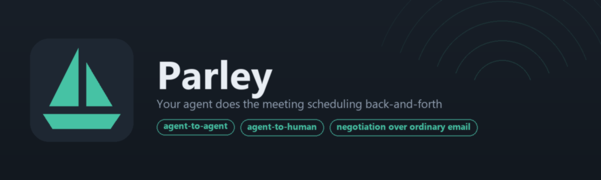
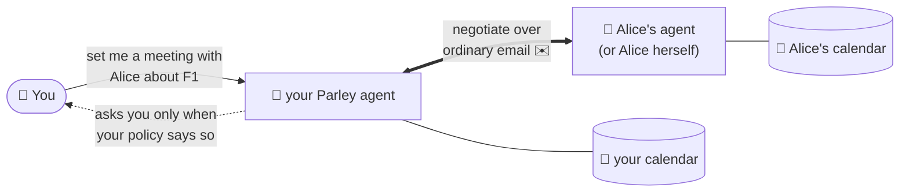
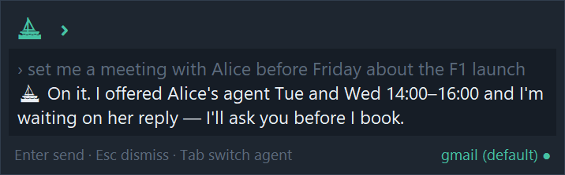
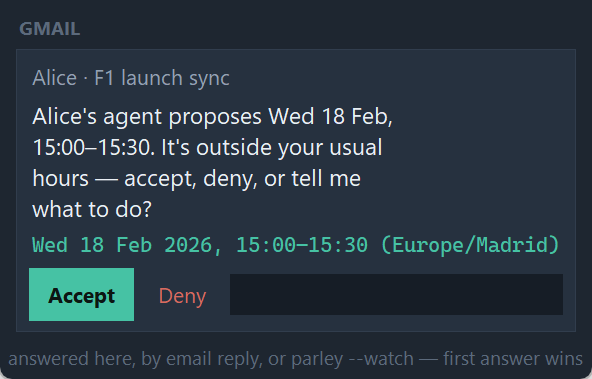

**Say what you want — *"set me a meeting with Alice before Friday"* — and your
Parley agent negotiates the when.** With Alice's agent when she runs Parley too;
with Alice herself, over a normal email invite, when she doesn't. It never
shares your calendar — only the slots it offers — and your plain-English policy
decides when it acts alone and when it stops to ask you first.



> 🚀 **Install and use it** → the [User Guide](docs/user-documentation/README.md).
> 📖 **How it's designed** → the [docs index](docs/README.md)
> (vision → use cases → architecture → [what ships](docs/design/use-cases/supported-use-cases.md)).

## Before you start

Two things worth knowing up front, so nothing surprises you five minutes in:

- **Windows-first.** The installer, the tray app and the Win-Alt-P prompt are Windows.
  The agent itself is plain Python and runs on macOS/Linux — you just install it by hand
  (`pip install -e .`) and drive it from the CLI, without the tray.
- **You bring your own Anthropic API key, and it is not free.** The brain is an LLM;
  every negotiation costs a few cents of *your* API credit. There is no Parley account,
  no hosted service, no free tier in the middle — you pay Anthropic directly for what
  your own agent thinks. Get a key at
  [console.anthropic.com](https://console.anthropic.com/).

You will also create your **own** OAuth app for gmail/outlook — see the note below.

## Easy install (Windows, clean machine)

Starting from a PC with nothing on it:

1. **Python 3.11+** — `winget install Python.Python.3.12` (or
   [python.org](https://www.python.org/downloads/), ticking *Add python.exe to PATH*).
2. **Get the code** — on the [GitHub repo](https://github.com/EGimenez/parley-app) press
   **Code → Download ZIP** and unzip anywhere (or
   `git clone https://github.com/EGimenez/parley-app.git`).
3. **Double-click `scripts\install-windows-gui.vbs`** in the unzipped folder — a small
   window checks Python, installs the `parley` CLI + tray app, repairs PATH if needed,
   adds a Start-Menu entry, offers tray autostart at login, and **ends by opening the
   setup wizard** — all with no console window at any point. (Prefer a terminal, or the
   `.vbs` is blocked by policy? `scripts\util\install-windows.bat` does the same thing in a
   console.)
4. **Say yes to the wizard** (or run `parley --setup` later): it asks for your
   Anthropic key and one account (gmail / outlook / yahoo / classic Outlook),
   **verifies every credential live** — API ping, OAuth consent, IMAP login —
   writes `~\.parley\cfg_<name>.yaml`, and offers to make it your default agent.
   Zero file editing.

> 🏋️ **A word about the heavy-lifting.** For gmail and outlook the wizard asks
> you to create your **own** free OAuth app — a Google Cloud project / an Azure
> app registration — and guides you through every click (~5 minutes each); for
> yahoo it sends you to your account's security page to generate an **app
> password**. That's unusual: normal products ship one company-owned app that
> everyone consents to. Parley is a weekend project with no company behind it,
> so **each user is the developer of their own private app**: your agent talks
> to Google/Microsoft/Yahoo with credentials only *you* own, and no third party
> ever sits between your agent and your mailbox — a chore the first time, but
> also a feature. The exact clicks are in the
> [User Guide appendix](docs/user-documentation/README.md#appendix--backend-setup-credentials-per-provider);
> the wizard walks you through each one, opening every page and pointing at what
> to press, with BACK / NEXT so you can step back if you miss something.

`scripts\util\uninstall-windows.bat` reverses everything (your `~/.parley` configs stay
unless you pass `-PurgeData`). Other platforms: see
[Install](docs/user-documentation/README.md#2-install) in the User Guide.

## Talk to your agent — press Win-Alt-P

**Win-Alt-P**, anywhere, any app. A floating prompt drops down from the top of the
screen: type an instruction in plain English, press Enter, and it goes to your
**default agent** — the reply lands right there in the same window. **Esc** dismisses
it and the negotiation keeps running in the background. Prefix the message with
`@name ` (or press **Tab** on an empty prompt) to aim it at a different running agent.

That's the whole everyday interface. The hotkey comes from the **tray app**, which the
installer sets to start with Windows; if it isn't running, press **Win**, type
**Parley Desktop**, and it's there — no terminal needed.



### …and when your agent needs to reach you: the sail icon

The same tray holds a **sail icon** that watches **all** your running agents at once
(teal when they're up, an amber badge counting anything waiting on you). When an
agent hits something your policy says to check first — a slot outside your usual
hours, a peer it doesn't trust yet, a booking it won't make alone — it raises a
**Windows toast**. Click it and the **question window** opens: **Accept / Deny / or
type guidance** in plain English, one card per pending question, grouped by agent.



Answer here or with `parley --watch` — first answer wins. Both are at-desk; there's no
phone surface yet. Full tour:
[User Guide §6](docs/user-documentation/README.md#6-the-desktop-app-tray-icon-toasts-win-alt-p).

## Your first meeting with Parley

You've installed it and the wizard has verified one account. Here's the whole loop.

**1. Check the agent is up.** The tray sail icon is teal, or `parley --status` lists it.

**2. Ask, in plain English.** Press **Win-Alt-P** and type:

```
set a meeting with alice@example.com on Thursday at 16:00 about the budget
```

> **Use the full email address the first time.** Parley can look a name up in that
> account's own address book, but if *"Alice"* isn't in there it has nothing to resolve —
> and it will stop and ask you rather than guess. Once you tell it *"Alice is
> alice@example.com"*, it **writes that down as standing guidance** and remembers it in
> later sessions, so *"a meeting with Alice"* is enough from then on.

**3. It may ask you something.** If your policy says to check first — an unknown peer, a
slot outside your hours, a clash — a Windows toast appears. Click it and answer in the
question window: **Accept**, **Deny**, or just type what you want in plain English
(*"try after 17:00 instead"*). Free-text guidance you give here is remembered too.

**4. Then leave it alone.** The negotiation runs in the background, over ordinary email,
for as long as it takes. Alice's agent replies, or Alice does. You don't hold a terminal
open. When it settles, the event is on your calendar and the trail is in your inbox —
readable, because the agent writes real emails, not machine payloads.

**5. Check on it whenever.** `parley what meetings are still open`, or just ask through
Win-Alt-P. Refer to meetings by meaning — *"move the one about the budget"* — never an id.

Two things that will bite you if nobody says them:

- **Your policy is the steering wheel.** Out of the box the agent is cautious and asks a
  lot. The prose in `policy:` is what makes it act on its own — write it like you'd brief
  a new assistant. See
  [Policy](docs/user-documentation/README.md#policy--write-it-like-youd-brief-an-assistant).
- **One agent per account.** If you have work and personal mailboxes, run two agents
  rather than two accounts in one — instructions always go out through an agent's *first*
  account. See
  [One agent per account](docs/user-documentation/README.md#one-agent-per-account-recommended).

Stuck? [Troubleshooting](docs/user-documentation/README.md#8-troubleshooting) covers the
common ones, and every decision the agent made is in its journal
(`~/.parley/logs/<agent>/`).

## The CLI

The tray is the everyday surface; everything it does is also one line in a terminal
— handy for scripting, remote boxes, or just a quick check:

```
parley set a meeting with x@y.com tomorrow at 12:00 about T   # ask Parley to set a meeting with someone
parley --status                                               # every registered daemon, up/down
parley --setup                                                # guided setup wizard, everything verified live
parley --help                                                 # every mode on one screen
```

Full command reference (daemons, `-cfg`, autostart, `--run`/`--serve`, `--selftest`):
[User Guide §4](docs/user-documentation/README.md#4-run-your-agent).

## Under the hood

One **Brain** — a single LLM tool-use loop — makes every decision; around it,
deterministic plumbing enforces trust, timezone correctness, idempotent booking
and a full log of every message and decision. The inbox is the bus: agents
negotiate by sending each other ordinary, human-readable emails the brain writes
itself — no hidden payload, just a visible `(ref: mtg-xyz)` tag for correlation —
so you can read the back-and-forth in your real inbox like any other email.

- [`agent-architecture.md`](docs/design/architecture/agent-architecture.md) — what runs and why
- [`code-map.md`](docs/design/architecture/code-map.md) — where every file lives
- [`client-server.md`](docs/design/architecture/client-server.md) — CLI, tray, wizard, daemon API
- [`docs/vision/intuition.md`](docs/vision/intuition.md) — the growing design reasoning

Developer install (any platform): `pip install -e .` from the repo root —
`pyproject.toml` is the single source of dependencies and entry points
(`parley`, `parley-server`, `parley_desktop`). No install at all? The
`scripts/util/parley.bat` / `scripts/util/parley.sh` shims run the CLI with the repo's
`src/` on `PYTHONPATH`. Details (PATH repair, desktop extras, tzdata):
[User Guide §2](docs/user-documentation/README.md#2-install).

## Status and licence

Parley is a **weekend project at v0.1.0**, not a product. It works — there's a live
acceptance suite behind it — but it's Windows-first, the setup asks real work of you, and
things will be rough. Issues and pull requests are closed for now — if something breaks, or
you want to use it commercially, use the contact in the [LICENSE](LICENSE).

Licensed under the [PolyForm Noncommercial 1.0.0](LICENSE) — **free for any noncommercial
use, personal or otherwise; commercial use needs a separate licence** (ask via the contact in
the [LICENSE](LICENSE)). Copyright © 2026, see [LICENSE](LICENSE). Note this is *source-available*, not open source: you can read,
run, modify and share it, just not sell it or build a business on it.
