# Parley Agent Architecture

> How one user's Parley agent is built and how a message flows through it. This is the
> **as-built** reference — it describes the code that runs today (post iteration 08–21,
> incl. the 8-tool collapse and human-readable peer mail).
> Why the design looks like this is [`intuition.md`](../../vision/intuition.md); the
> agent↔agent *wire* is [`communication-protocol.md`](communication-protocol.md); the
> human↔agent *channel* is [`client-server.md`](client-server.md); vocabulary is the
> [glossary](../glossary.md); where the design is heading is
> [`agent-architecture-future-development.md`](../../iterations/agent-architecture-future-development.md).

One **Agent** speaks for one human. Since iteration 08 there is **one decision-maker**:
the **Brain** — a single LLM tool-use loop that runs once per admitted event, reads the
policy prose plus a summary of *all* open negotiations, and acts through thin tools.
Everything else is deterministic plumbing: a **Guardrail** rules every boundary
crossing (intake and every tool call) `ALLOW | ASK | DENY` from a per-account **trust
table** (iteration 12), a **Gateway** decides relevance for the residual plain mail
(cheap rules + an optional small-model classifier), a **ToolBelt** executes dumb verbs,
**NegotiationMemory** carries working state across events and restarts, the **Journal**
records every message and decision, and **wire.py** encodes/decodes the peer-to-peer
messages. No deterministic scheduling engine remains.

Flow: **poll → trust (guardrail) → relevance (gateway) → brain (memory + event) → thin
tools → guardrail → persist.**

---

## Two channels, never conflated

Every message belongs to exactly one of two channels, and the code never mixes them:

- **Client–server** — the human ↔ their *own* agent. Bidirectional: the human instructs
  (`instruct`, from the CLI or the tray) and the agent asks back (a pending question over
  HTTP, surfaced as a tray toast). All of it HTTP on `127.0.0.1` — an earlier
  email-to-self variant was retired 2026-08-31. **Not** routed through the gateway. Spec:
  [`client-server.md`](client-server.md).
- **Peer-to-peer** — the agent ↔ *other* agents (and real human invites). Comes off the
  inbox poll, through the **Gateway**, to the Brain. Spec:
  [`communication-protocol.md`](communication-protocol.md).

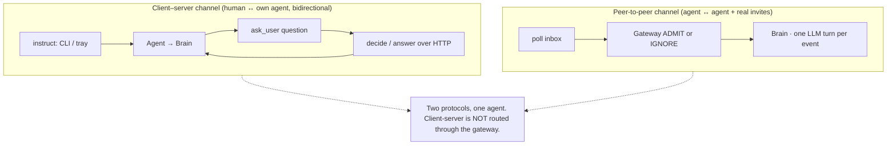

The `ask_user` / `send_email` distinction matters: asking **your own human** is
client-server; emailing **someone else** is peer-to-peer. Different tools, different
audiences.

## System context — who talks to whom

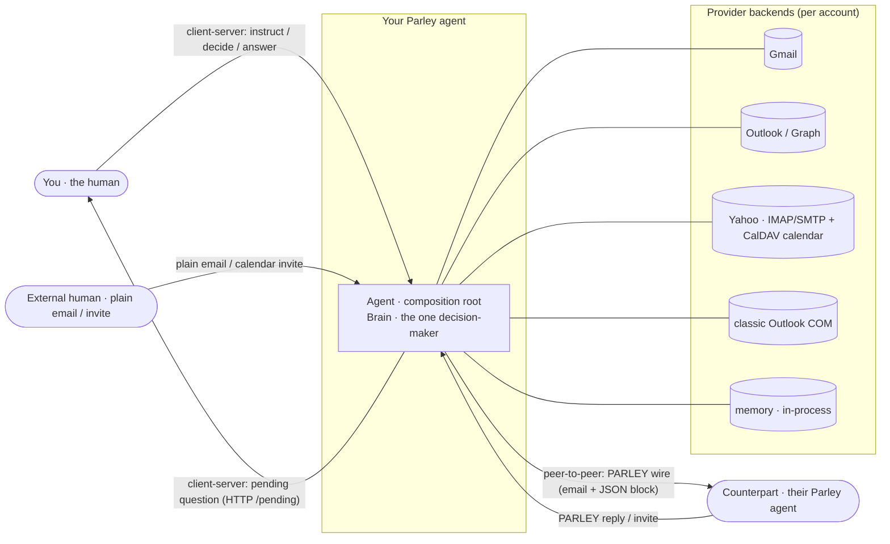

---

## The pieces

```
Agent (one per user — plumbing, not decisions)
 ├─ Account(s) ............ the accounts it speaks for (mailbox + calendar + contacts I/O)
 ├─ run() loop ............ polls each account, hands each message to handle()
 ├─ Guardrail (per acct) .. THE permission model: trust table → ALLOW | ASK | DENY
 │                          at intake AND on every tool call (one-shot grants on accept)
 ├─ Gateway (per account) . relevance for residual plain mail: rules + optional
 │                          small-model classifier (fail-open): ADMIT | IGNORE
 ├─ Brain (per account) ... THE decision-maker: one LLM tool-use turn per admitted event
 ├─ llm_port .............. provider-agnostic LLM seam (the only vendor-SDK import)
 ├─ ToolBelt (one) ........ thin, conn-explicit, guardrail-gated verbs — no judgment
 ├─ Policy (per account) .. DATA: prose (brain) + trust table (guardrail) + learned file
 ├─ NegotiationMemory ..... working state across concurrent negotiations (persisted)
 ├─ Journal ............... flight recorder: every message + every decision, daily JSONL
 ├─ wire.py ............... deterministic peer-to-peer parse/emit (no choreography)
 └─ awaiting .............. escalations parked for the human (ref → question)
```

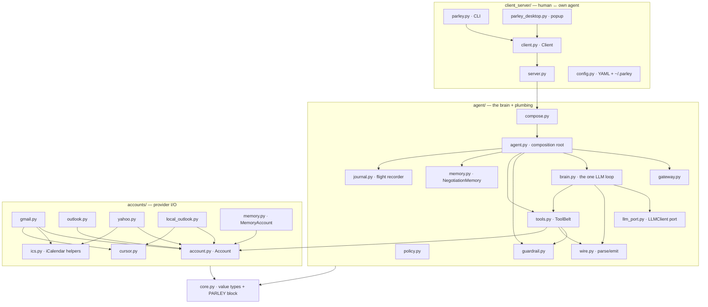

### Account — `parley/accounts/`
The provider-agnostic I/O surface for **one** mailbox + calendar + contacts: `connect`,
`address`, `timezone`, `fetch_new_messages`, `send`, `events_overlapping`,
`move_event`, `create_event`, `delete_event`, `resolve_contact`, and `accept_request`
(overridden by real backends to RSVP a received invite instead of creating a duplicate).
It knows nothing about negotiation. Concrete backends: `gmail.py` (Google API),
`outlook.py` (MS Graph), `yahoo.py` (IMAP read + SMTP send + **CalDAV calendar** —
iteration 17: real free/busy and own-calendar events; degrades loudly to mail-only if
discovery fails), `local_outlook.py` (classic Outlook COM), `memory.py`
(credential-free in-process backend that drives `--selftest`). `ics.py` holds shared iCalendar parse/build; `cursor.py` the
durable intake cursor. Real-SDK backends import lazily so the selftest needs no provider
libraries.

### Gateway — `parley/agent/gateway.py`
The **relevance funnel**, two-stage since iteration 12 (trust moved to the Guardrail;
the old `allow_from` folds into the trust table as `auto`):

1. **Deterministic, free:** a structured PARLEY message or real invite (anything
   `wire.parse` gives a `type`) is always admitted; bulk senders (`no-reply@…`) drop;
   the opt-in keyword (default `"parley"`) admits; `route_plain_to = "ignore"` forbids
   plain mail entirely.
2. **The residual plain mail:** an optional **LLM classifier** — a small, cheap model
   configured in the top-level `[llm-gateway]` table next to `[llm]` (own
   provider/key optional, defaulting to the brain's; per-account override via
   `[account.gateway] model`) answering one binary ADMIT/IGNORE question — decides;
   without one, or on **any classifier failure (fail open)**, the lexical
   scheduling-words heuristic decides as before. One call per message id (cached);
   every classifier verdict journaled (`by: classifier`).

The principle stands: *determinism is the funnel; the LLM sits at the narrow end* — and
the classifier is itself funnel-shaped (sees only what stage 1 couldn't decide,
truncated input, cached verdict).

### Brain — `parley/agent/brain.py` — the one decision-maker
One per account (each carries that account's policy prose); every admitted event becomes
**one tool-use turn**:

- **Context per turn** (the system prompt): who it speaks for, the current time in UTC
  *and* the calendar's timezone, the policy prose **plus learned guidance**, and a compact
  summary of **all open negotiations** (`NegotiationMemory.summary()`; full history on
  demand via the `get_negotiation` tool — decision #10).
- **Three entry points:** `handle(message)` (admitted peer mail), `instruct(text)`
  (client-server instruction), `user_answered(question, answer)` (the human's reply to an
  escalation — the brain *re-plans* on it, decision #9).
- **Correlation is deterministic:** the wire `negotiation_id` maps an inbound to its
  negotiation before the model runs; the brain is *told* which negotiation an event
  belongs to (never guesses).
- **The loop:** up to `MAX_STEPS = 8` model calls; each tool call is dispatched to the
  ToolBelt **with `conn` injected** (the account is never a model-visible argument); a
  failing tool returns an error result, never crashes the turn. Every step is journaled.
- **No LLM ⇒ no action:** without a configured client the brain logs loudly and refuses
  (LLM-only, decision #1). A key without a `model` is a fatal config error — no default
  model is ever assumed.

The model-facing tool catalogue — **8 tools since iteration 21** (defined in `brain.py`,
executed by the ToolBelt). The earlier 16-verb surface collapsed to eight composable
primitives; the old names stay dispatchable through a legacy shim (`_LEGACY_TOOLS`) but
are **never shown to the model** (the felt "the agent gets confused" was the model
adjudicating five overlapping send tools + a dual-role `create_event`):

| Tool | Kind | What it does |
|---|---|---|
| `send` | gated send | the ONE peer-messaging tool — verbs OFFER / ACCEPT / DECLINE / CANCEL / TEXT (absorbs `send_meeting_request` · `propose_time` · `decline_meeting` · `confirm_meeting` · `send_email`) |
| `apply` | **binding** | the ONLY tool that writes a calendar — `change` = create / move / cancel / rsvp; one guardrail choke point (absorbs `create_event` · `move_event` · `delete_event` + auto-RSVP; book-vs-RSVP is the `change` argument, not two tools). Books (asker) or RSVPs a received invite (answerer, `must_rsvp` — never a duplicate); settles the negotiation; the **conflict guard** refuses a busy slot unless overridden (policy-or-human) |
| `check` | read | busy blocks in a window — union across **all** the agent's accounts; `who`=a peer returns `accessible:false` (you can't see others' calendars → email them for times) |
| `lookup` | read | the ONE read helper — pass exactly one of `ref` (full history of one negotiation) / `contact` (display name → address) / `events` (search own calendars by meaning, so "the meeting about F1" resolves even after its negotiation is forgotten) |
| `ask_user` | client-server | escalate to the human (free-text answer supported) |
| `close` | memory | memory-only close of a negotiation the user abandoned ("never mind"); the peer gets a `send(CANCEL)` separately if already contacted |
| `remember_policy` | memory | persist standing guidance the user just gave (override-as-training-data) |
| `defer_action` | memory | record a **conditional next step** ("once X reschedules, accept Y") as a durable follow-up shown every turn — makes cross-negotiation guidance resumable instead of dropped |

The binding boundary is now explicit **in the surface**: `send` never mutates a calendar;
`apply` is the only tool that does — the brief's negotiate/commit split, carried by the
tool instead of inferred from a verb name. Intent still gets a durable id the first turn
(the old `open_negotiation` role): the first `send`/`apply` on a new topic mints it.

### LLM port — `parley/agent/llm_port.py`
The provider seam (decision #8): the brain talks to `LLMClient.complete(system,
transcript, tools)` over a neutral transcript format; **this module is the only place a
vendor SDK is imported**. Adapters: `AnthropicClient` (today) and `FakeLLMClient` (a
scripted/planner stand-in — the token-free `--selftest` injects it). Swapping providers
is one new adapter; there is **no agent framework** (iteration 08's three-jobs argument:
the loop is small, the tools and the memory are domain logic and stay ours).
The Anthropic adapter sets **prompt-cache breakpoints** (`cache_control: ephemeral`) at
the tools → system → messages boundaries — the last tool schema (static across turns),
the system block (frozen per turn), and the last message block (the growing loop
transcript) — so the large tools+system prefix is re-read cheaply across a multi-step
turn and across turns within the 5-minute TTL; `LLMResponse.usage` surfaces
`cache_read`/`cache_write` to the journal for verification.

### ToolBelt — `parley/agent/tools.py` — thin hands, no judgment
Each tool is a dumb verb; *all* deciding lives in the brain's prompt + policy (decision
#2). Two invariants: **connection-explicit** (every tool takes the `conn` it acts on) and
**guardrail-gated** (writes and outward mail check the account's Guardrail first). Plus
two guarantees that are deliberately **infra, not model behavior**:

- **One timezone conversion** (`_when`, iteration 09): the model never converts zones —
  it passes a local wall-clock time or an offset time verbatim; `_when` interprets local
  times in the calendar's zone and converts to UTC. An unresolvable zone **raises**
  loudly (iteration 11: a silent UTC fallback booked wrong instants) — and
  `Agent.check_timezones()` probes every zone at startup.
- **Idempotent settlement** (`create_event`, iteration 09): a terminal `negotiation_id`
  → no write; an event for the same (peer, overlapping slot) → no second write; the
  calendar write closes the negotiation as `booked` at the moment it happens
  (first-write-wins — never left to the model).

### Guardrail — `parley/agent/guardrail.py`
**The one permission model** (iteration 12, S4+S5): given an `Action` (`kind`, `conn`,
`target`, …) it returns **ALLOW | ASK | DENY**, at **both** boundaries —

- **intake:** every peer message is `Action(kind="handle_inbound", target=sender)`
  *before* relevance or the brain get a say — `DENY` is a journaled drop, `ASK` parks
  the whole email as a human question ("engage with this?");
- **outbound:** every mutating ToolBelt call, where `ASK` is a real gate, not a silent
  hold — the action is parked (`/pending` + the ask email), and an affirmative answer
  grants a **one-shot** approval (`Agent.grants`) so the brain's retry passes exactly
  once. A denial grants nothing; the brain re-plans on the human's words.

Verdicts come from the per-account **trust table** (`Policy.structured["trust"]`):
`principal → auto | ask | ignore`, with per-verb overrides
(`"b@co": { default = "ask", create_event = "auto" }`). **The empty guardrail ALLOWs
everything** and only narrows where the table says so; the table *bounds authority*
while policy prose keeps *nuance* — and the table always wins (`ignore` drops no matter
what the prose says). The retired `accept_requests_from` / `gateway.allow_from` keys
fold in as a shim. The brain remains the judgment (`ask_user` when prose says so); the
guardrail is the independent authority that doesn't depend on the brain choosing to ask.

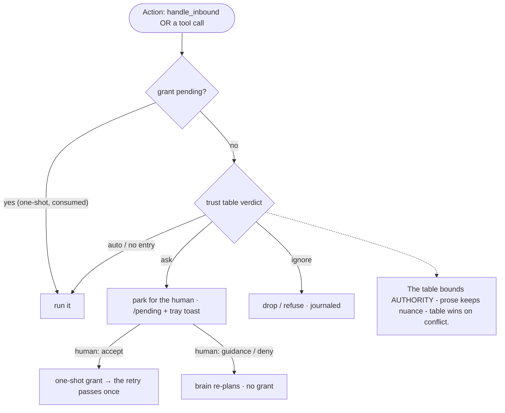

### Policy — `parley/agent/policy.py` + the learned file
Decision **data**, not code, per account — three artifacts, each with one owner
(iteration 12, S12):

| Artifact | Owner | Example |
|---|---|---|
| `unstructured` prose (+ `policy_learned.md`) | the **brain** (judgment) | "ask me before new meetings; prefer mornings" |
| `trust` table | the **Guardrail** (authority) | `"boss@co" = "auto"` |
| the rest of `structured` | infra (shims, limits) | `accept_requests_from` (shim) |

**Learned guidance**: when the user's answer contains a standing rule ("from now on
keep Fridays free"), the brain's `remember_policy` appends it to
`~/.parley/state/<account>/policy_learned.md`, and every future turn reads it **with
the same weight as the base policy**. Every human decision is also journaled as
*(principal, verb, verdict)* — the raw material for suggesting ask→auto trust
graduations later. Override-as-training-data, running today in its simplest form.

### NegotiationMemory — `parley/agent/memory.py`
The working state across concurrent negotiations — the one piece no framework can own
(decision #3): each negotiation is `{id, peer, topic, direction, status, slot, account,
aliases, parties, thread, transcript, …}`; open stages
`open | proposing | awaiting_peer | awaiting_human`, terminal
`booked | declined | cancelled | deadlocked | superseded`. Persisted to
`~/.parley/state/<agent>/negotiations.json` so open negotiations survive a restart
(decision #4). Terminal negotiations are **retained, not popped** — `is_terminal` is the
idempotency guard that drops repeat wire messages, and `close()` on an unknown id still
writes a **tombstone** (iteration 11) so a first-contact confirmation can never be
double-committed. `find_settled(peer, start, end)` recognizes the same physical meeting
travelling under different ids (wire id vs. the invite's deterministic `mtg-` id).

Since **human-readable messaging (Phase 2)** each negotiation also records the Message-IDs
of its mail thread (`thread`, via `link_thread`): an untagged human reply in plain prose
— no machine payload at all — correlates back **thread → (peer, topic) → reply-only
peer-alone** (`neg_for_thread` / `open_by_peer_topic`), with genuine ambiguity escalating
to the human rather than mis-correlating into the wrong meeting.

### Journal — `parley/agent/journal.py`
The flight recorder (iteration 10): **every message received and every decision made**
is one JSON line in `~/.parley/logs/<agent>/journal-YYYY-MM-DD.jsonl`, echoed to the
console when a human is watching — screen and file never diverge, and **nothing is
dropped silently** (every drop is a journaled `drop` with a reason). Never crashes a
turn; open-append-close per write (crash-safe, rolls at midnight); sees runtime traffic
only, never cfg contents. In-memory tail (`records`) serves the selftest.

### Wire — `parley/agent/wire.py`
What must stay deterministic for interop + privacy: how a message is encoded in an email
and read back. Five message types — `meeting_request`, `availability_request`,
`request_confirmed`, `proposal`, `decline` — each emitted since **human-readable messaging
(2026-07-22)** as a **self-sufficient human sentence** (title, date, both times, timezone,
introduced with the user's name via `user.name` → `_intro`) with the machine payload
hidden in an **HTML comment** — `<!-- PARLEY {json} -->` (`core.PARLEY_COMMENT`) — so a
person on the other end reads clean prose while a peer agent still gets the JSON.
`parse()` reads the payload from that hidden comment, falling back to the legacy visible
`-----BEGIN PARLEY-----` block for back-compat (**parsed inbound, never emitted**). When
even the hidden carrier is stripped in transit (Graph strips HTML comments; some IMAP
fetches drop the html part), an `availability_request` is re-synthesized from the
`Finding a time: <topic>` **subject** so cross-provider correlation still survives. A real
calendar invite with no payload is **normalized into** a `meeting_request` tagged
`via_invite` (slot is fixed; RSVP, don't negotiate) with a **deterministic id** —
`mtg-i<hash(iCalUID)>` when the UID is present, else `<hash(organizer|start|end)>` — so
every resend maps to the same negotiation. An invite carrying a REPLY, or a provider's
**plain RSVP-notification** subject (`Accepted:` / `Declined:` / `Tentative:` with no iCal
REPLY), is normalized into an `rsvp_reply` — correlated by (peer, topic) when it carries
no times — so a bare "Declined: X" reaches the asker instead of being dropped as noise.
No policy, no choreography — that all moved into the brain. The richer UID-keyed target
wire is [`communication-protocol.md`](communication-protocol.md) §4–6.

### Agent — `parley/agent/agent.py`
The composition root, shrunk to plumbing (iteration 08): builds per-account Gateway +
Guardrail + Brain, the one ToolBelt, memory + journal; owns the run loop, the `awaiting`
human gate, and the client-server bindings. Two human-gate guarantees live here:
**one ask per thing** (`escalate` is idempotent per (account, negotiation) — a repeat
ask reuses the pending item, no second notification) and **first answer wins**
(`decide` pops the item under the server lock; the losing channel's duplicate is
journaled and ignored).

### Composition + entry points — `compose.py`, `__main__.py`
`client_server/config.py` parses one YAML file = one human: a top-level `llm:` mapping
(key + `model` + optional `tz`) and one or more `account:` entries. `agent/compose.py`
holds the backend registry and wires the paths (`~/.parley/state/<agent>/`
negotiations + learned policy, `~/.parley/logs/<agent>/` journal). Entry points stay
thin: `python -m parley` (`--selftest` / foreground / `--serve`),
`client_server/server.py` (`serve_from_config`), `parley_start_server.py`
(`parley-server`). `core.py` holds the dependency-free value types (`Slot`, `Message`,
`Event`) and the PARLEY carrier encode/parse — the hidden `<!-- PARLEY -->` HTML comment
(emit + read) plus the legacy `BEGIN/END` block (read-only, back-compat).

---

## Inbound dispatch — `Agent.handle()`

Journal first, then a fixed sequence of deterministic guards; the brain is the last
stop, not the first:

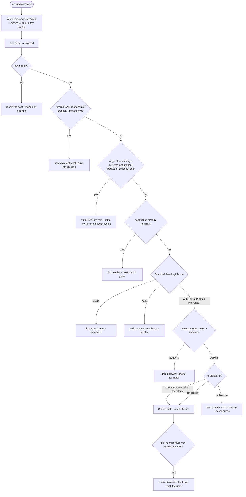

## Privacy boundary — inward-full, outward-minimized

The boundary is the **wire**, not the prompt. The brain works for its own human with the
human's own key, so it sees the user's own data in full: `check_availability` returns the
busy blocks **with titles and attendees** (union across all the agent's accounts), and
the admitted email's text enters the prompt. What is minimized is what **leaves**: the
wire carries only offered slots, titles the user chose to share, and accept/decline —
never the calendar, never why a slot is busy, never that a conflicting event exists.

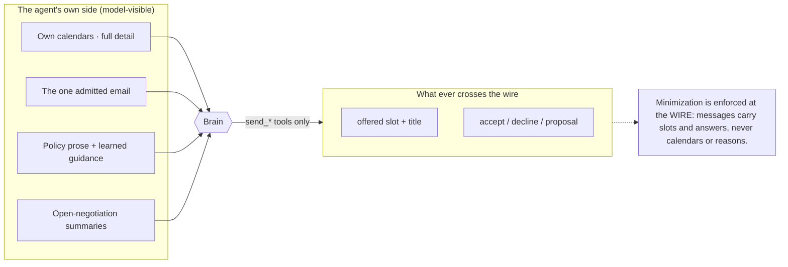

---

## Behaviour

> The sequence diagrams below label steps with the **pre-21 verbs** (`create_event`,
> `confirm_meeting`, `propose_time`, `move_event`) for readability; on today's surface
> these are `apply(create)`, `send(ACCEPT)`, `send(OFFER)`, and `apply(move)`
> respectively. The flow is unchanged — only the tool names collapsed (see the catalogue
> above).

### Direct booking at a fixed time (asker owns the event — ONE email)

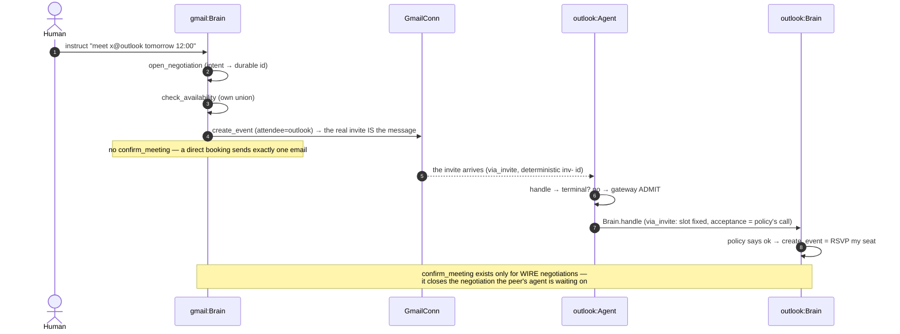

### Human-gated acceptance (policy prose → ask_user)

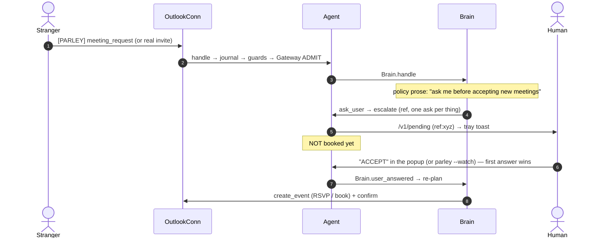

### Collision → displacement (cross-negotiation, from working memory)

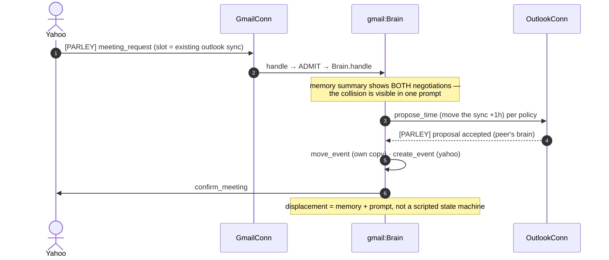

---

## State & data (as-built)

Concurrent negotiations are keyed by `negotiation_id` in `NegotiationMemory`;
escalations by `ref` in `Agent.awaiting`. The full **target** lifecycle (14 states, both
channels) is the [protocol state catalogue](communication-protocol.md#43-state-catalogue);
what the code distinguishes today is smaller:

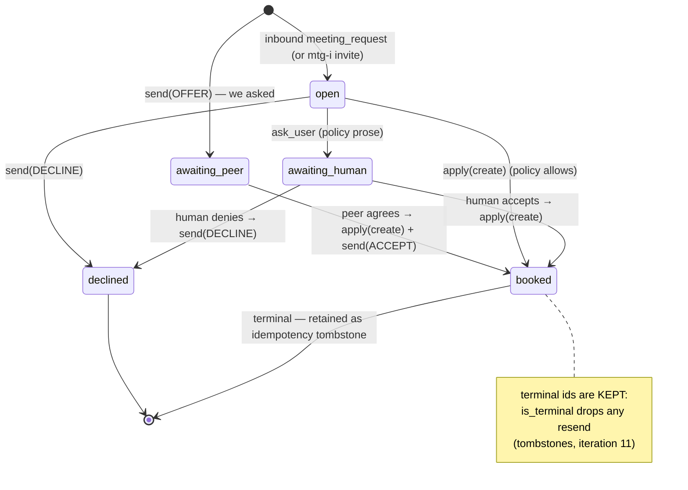

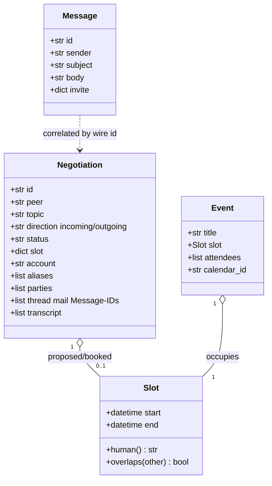

(The vestigial `Resolution` dataclass was removed from `core.py` in iteration 12.)

---

## What stays deterministic (the floor under the LLM)

| Concern | Guaranteed by | Not by |
|---|---|---|
| Who may do what (authority) | the Guardrail's trust table at intake + every tool call; `ignore` beats prose; one-shot grants | the brain choosing to ask |
| Noise rejection / cost | Gateway stage 1 (rules) + a cheap cached classifier that fails open | the big model reading everything |
| Observability, no silent drops | journal-first in `handle()`; every drop has a reason | console luck |
| Timezone correctness | `ToolBelt._when` — the ONE conversion; loud failure; startup probe | the model converting in-prompt |
| Booking idempotency | terminal-id guard + (peer, slot) dedupe + tombstones — settlement is infra | the model "remembering" it booked |
| **Never silently double-book** | the conflict guard in `create_event`: a different-peer overlap refuses unless explicitly overridden (policy-or-human), journaled | the model noticing the clash |
| **Invite fates are recorded** | `rsvp_reply` handled by infra before the brain: accepted → recorded; declined → reopen + wake the brain — from an iCal REPLY **or** a plain "Declined:" notification (never a silent gateway drop) | the classifier admitting reply mail |
| **RSVP never duplicates** | `must_rsvp` on invite-originated accepts: retry for the event, raise rather than create | the backend's find-then-fallback race |
| **RSVP-not-landed defers to infra** | a not-yet-materialized invite raises `InviteNotReady`; `create_event` records a `pending_rsvp` and returns "done, don't retry"; the poll loop completes it (or escalates after the limit) — the model never retries into `MAX_STEPS` | the model hammering `create_event` |
| **Can't see a peer's calendar → email, not guess** | `check_availability(who=peer)` returns `accessible:false`; the brain emails for availability rather than inventing a slot (real peer free/busy later fills the same seam) | the model assuming the peer's free time |
| **Conditional guidance is resumable** | `defer_action` records a follow-up on the blocked negotiation, surfaced every turn; when the unblocking event arrives the brain completes it — "reschedule with X, then accept Y" survives the peer round-trip | the model forgetting the second step across turns |
| **Silent peers don't stall forever** | the poll-loop stall timer wakes the brain to nudge a no-reply `meeting_request` once, then escalates to the user; a `stalls` counter stops per-poll re-firing | a negotiation waiting on a ghost indefinitely |
| **No silent inaction** | a meeting-request turn with no outward action and no ask → `silent_inaction` + escalation to the human; the per-turn context is frozen so the model's own writes can't read as prior handling | the model deciding "nothing to do" |
| **Answers carry ground truth** | every mail-born ask resumes with the ORIGINAL mail (machine payload); a create toward a peer with a pending invite must answer that invite (`counter_invite_hold`) | the model's memory of its own question prose |
| Correlation across concurrent negotiations | the wire `negotiation_id` / deterministic `inv-` ids | the model guessing threads |
| Confirmation asymmetry (no ping-pong) | only the asker sends `request_confirmed`; auto-RSVP of settled invites | prompt discipline alone |
| Human-gate integrity | one-ask-per-thing (idempotent escalate) + first-answer-wins (pop under lock) | client goodwill |
| Which account acts | the explicit `conn` argument injected by the brain | inferring the connection |
| Model choice | cfg `[llm] model` — missing model with a key = fatal, no silent default | a hardcoded fallback |
| Offline testability | `FakeLLMClient` + `MemoryAccount` (47-check `--selftest`, token-free) | a live key |

The LLM gains **judgment** (accept? move? propose? ask? what prose?). It gains no
authority the tools and infra guards don't already permit.

---

## Config model

**One YAML file = one complete, private agent** (iteration 07-0), living in
`~/.parley/`, never in the repo:

```yaml
user:                                  # who the agent speaks for
  name: "Alex"                         # Parley introduces itself with this name in peer
                                        # mail ("Hi, this is Parley, Alex's assistant…")

llm:                                   # the brain
  anthropic_key: "sk-ant-…"            # or anthropic_key_file
  model: "claude-sonnet-4-6"           # REQUIRED with a key — no default model. The brain
                                        # gets the capable model; Haiku goes on the gateway.
  # tz: "Europe/Madrid"                # optional override; default = each calendar's zone

llm-gateway:                           # the intake classifier (S15) — a SMALL model
  model: "claude-haiku-4-5"            # provider / anthropic_key optional; default = llm:'s

account:
  - backend: outlook                   # gmail | outlook | yahoo | local-outlook | memory
    address: you@outlook.com
    client_id: "…"                     # backend settings (inline secrets + state names)
    calendars: [primary]               # busy-union; first = booking target

    policy:
      unstructured: |                  # the prose the brain follows (judgment)
        Ask me before accepting new meetings.
        Meetings with customers take priority.

      trust:                           # the guardrail's table (authority)
        "boss@example.com": auto       # auto | ask | ignore
        "noisy@list.com": ignore
        "new@person.com": { default: ask, send_email: auto }  # per-verb override

      # accept_requests_from: ["…"]    # retired — still read as a shim

    # gateway:                         # optional per-account relevance knobs
    #   model: "…"                     # override the llm-gateway: model for this account
    #   route_plain_to: ignore
```

Generated state lands under `~/.parley/state/<name>/` (token, cursor, `negotiations.json`,
`policy_learned.md`) and logs under `~/.parley/logs/<name>/` (journal + spawned-server
log). See [client-server.md §5](client-server.md).

## Package layout

```
src/parley/
  core.py                  value types + the PARLEY carrier (hidden HTML comment + legacy block)
  __main__.py              python -m parley umbrella (--selftest / run / --serve)
  parley_start_server.py   parley-server console entry (+ .sh/.bat)
  agent/    agent.py brain.py llm_port.py gateway.py guardrail.py tools.py
            policy.py memory.py journal.py wire.py compose.py
  accounts/ account.py gmail.py outlook.py yahoo.py local_outlook.py memory.py
            ics.py cursor.py
  client_server/ server.py client.py parley.py parley_desktop.py config.py
  testing/  selftest.py fakes.py
```

---

## Where it's heading (deferred)

The shape above is stable; the known next steps live in two exploration docs:

- **[`agent-architecture-future-development.md`](../../iterations/agent-architecture-future-development.md)**
  — the architecture/policy simplification survey: one permission model at every
  boundary, a per-principal trust table, everything-is-an-event, one store + one log,
  the Account surface mirroring the tool surface.
- **[`communication-protocol-future-development.md`](../../iterations/communication-protocol-future-development.md)**
  — the compact protocol: 4 states × attributes, 4 peer verbs, one correlation id.

Nearer-term items tracked on the board / in the protocol doc: UID-based identity and the
negotiate-vs-commit write boundary (today `create_event` can run mid-exchange),
working-hours enforcement + calendar roles (UC-6), Yahoo CalDAV free/busy, a calendar
change-watch for human-steps-in reconciliation (UC-5), and ask→auto trust
**graduation suggestions** computed from the journal's (principal, verb, verdict)
records.

An alternative orchestrator on the Claude Agent SDK was spiked and validated (iter 05),
then **retired** in the one-brain simplification (iter 08): the native loop is lighter
(one HTTP call, no subprocess) and the only offline-testable path. The SDK path is
still reachable behind `PARLEY_ORCHESTRATOR=sdk` (optional `sdk` extra).
