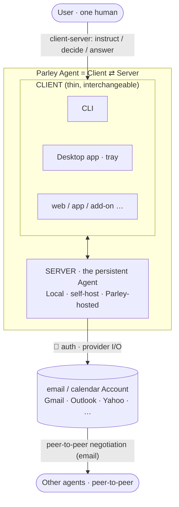
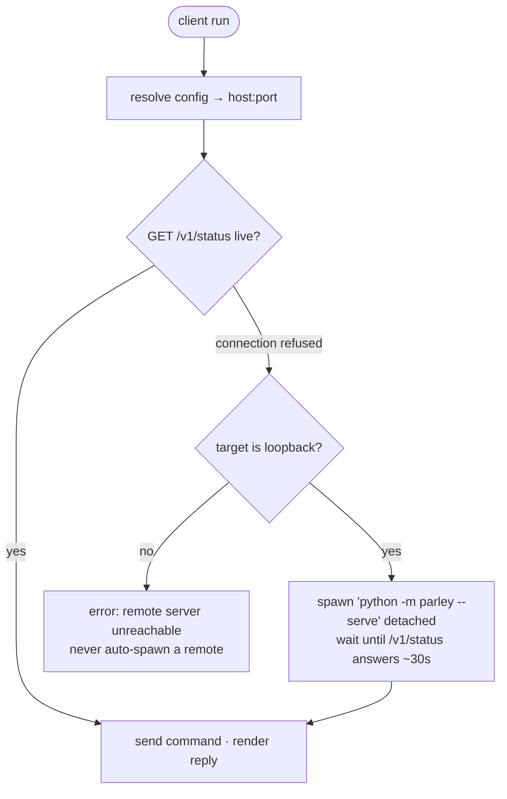

# Parley Client–Server

> The human↔agent channel: how a person reaches their own Parley agent. Companion to
> `interface-use-cases.md` (the surfaces), `communication-protocol.md` (the agent↔agent
> wire) and `agent-architecture.md` (Agent/Policy/Account). The peer-to-peer wire is a
> *separate* protocol — the two never mix (§1, §10 of the protocol doc).

---

## 0. Topology



- The **User** talks only to **their** Parley Agent (never to a counterpart directly).
- A Parley Agent is a **Client ↔ Server** pair. Clients are thin and interchangeable;
  the Server is the persistent agent. Which **deployment** the server is (Local /
  Open-source-self-host / Parley-hosted) is a config choice — see §2.
- The Server reaches the world through its **email / calendar Account(s)** (🔑 = the
  account's auth). That same account link carries the **peer-to-peer** negotiation to other
  agents (account → account over email). Clients never touch the account.

---

## 1. Two protocols, never conflated

| Protocol | Between | Transport | Spec |
|---|---|---|---|
| **Client–server** | human's client ↔ their own server | HTTP/JSON on `127.0.0.1` | this doc |
| **Peer-to-peer** | server ↔ other agents (negotiation) | email (iTIP + sidecar) | `communication-protocol.md` |

The server is the persistent `Agent`. Clients are thin: they translate a human
instruction into one client-server call and render the reply.

---

## 2. One server, three deployments — differ only by bind + auth

| Deployment | Binds | Auth | License | Auto-start by client? |
|---|---|---|---|---|
| Local (own machine) | `127.0.0.1:8787` | none (loopback) | open-source | **yes** (spawn if down) |
| User-owned host | `0.0.0.0:8787` + TLS | bearer token | open-source | no (operator runs it) |
| Parley server | domain + TLS | token / SSO | hosted | no |

Same `server.py`. Deployment = config (`server: host/port/auth`). **Only Local ships
today**; the API is written host-agnostic so the others are a config flip.

---

## 3. Client-server API (v1)

All JSON. Base `http://127.0.0.1:8787`.

| Method · Path | Body | Returns | Purpose |
|---|---|---|---|
| `GET /v1/status` | — | `{name, addresses[], connections[], open_negotiations, pending}` | health + identity; client uses it to detect a live server |
| `POST /v1/instruct` | `{text}` (free text) | `{status: done\|question, ref?, question?, message}` | delegate — the brain comprehends, plans, acts; answers DONE or a QUESTION the client can reply to |
| `GET /v1/pending` | — | `[{negotiation_id, kind, summary, from, title, start, end, question, asked_at}]` | escalations awaiting the human (the human gate). `summary` is one line (≤120 chars) for the card; `question` is the full text |
| `POST /v1/decide` | `{negotiation_id, choice}` | `{ok}` | accept / deny / free-text guidance (the brain re-plans on it) |
| `POST /v1/answer` | `{ref, answer}` | `{ok}` | alias of `decide`, keyed by the escalation's `ref:<id>` marker |
| `POST /v1/dismiss` | `{negotiation_id, reason?}` | `{ok}` | close a question **without** answering it (handled elsewhere / no longer matters). Silent: no brain turn, nothing sent |
| `POST /v1/shutdown` | — | `{ok}` | stop a local daemon |

| `POST /v1/focus` | `{action: create\|list\|cancel, ...}` | `{ok, dfb_id, state, placed}` / `{ok, blocks}` | Dynamic Focus Blocks: time kept before a meeting (`agent/focus.py`); `parley --focus` |

All eight are **live**. An escalation is answerable on any surface — the desktop popup or
an attached `parley --watch`, both over HTTP — first answer wins, duplicates are ignored
(`agent.decide` pops the item under the server lock). Both surfaces are at-desk: the
email-reply path that once made this answerable from anywhere was retired in the
2026-08-31 refactor and not replaced.

**The ASK/END contract** (user decision 2026-07-05): every agent→client reply is
**ASK** (`status: question` — the connection stays open; the client renders the
question and returns the answer; follow-ups chain) or **END** (`status: done` — the
client prints the reply and exits immediately). The brain decides which: a status
query ENDs with the list, or ASKs ("which one?") when it needs a pick. Long-running
negotiations never hold the terminal: their later questions go to the desktop popup,
or to an explicitly attached `parley --watch` (polls `/v1/pending`, every parked
question from any negotiation, Ctrl+C detaches).

### Instruction format
Free text only. Since the one-brain simplification (iteration 08) there is no
client-side structured-intent form: the server hands `{text}` to the brain
(`agent/brain.py`), which comprehends, plans, and acts — every mutating step still
guardrail-gated.

---

## 4. Server lifecycle (local daemon)



- The spawned daemon logs to `~/.parley/logs/server-<port>.log`; first-run OAuth opens a
  browser (Gmail `run_local_server`, Outlook MSAL). The client tells the user where
  the log is while it waits.
- Daemon keeps polling/negotiating across commands (the always-on peer-to-peer loop).

---

## 5. Config resolution + `--default`

`~/.parley/` is the private home for **everything an agent needs**, off any
cloud-synced tree (iteration 07-0): `cfg_<name>.yaml` (the agent's `llm:` key + inline
account secrets + policy), `state/<name>/` (generated tokens / MSAL cache / delta +
intake cursor), `default` (one line: a config path), `logs/` (spawned-server logs), and
the per-backend `cfg.<backend>.example.yaml` templates seeded on first run. Nothing
secret lives in the repo; a relative path in a cfg resolves against `~/.parley`.

| Invocation | Resolution |
|---|---|
| `parley -cfg gmail` | `gmail` → first hit of: literal path · `config/cfg_gmail.yaml` · `~/.parley/cfg_gmail.yaml` |
| `parley -cfg gmail --default` | resolve as above, then write the path into `~/.parley/default` |
| `parley <text>` (no `-cfg`) | read `~/.parley/default`; if absent → error telling the user to set one |
| `parley -cfg X <text>` ×3 with no default | after the 3rd use, one-time hint to set it as the default (`~/.parley/usage.json`) |

`server:` mapping in the config (optional) sets `host`/`port`; default `127.0.0.1:8787`.

---

## 5b. Servers registry, tray app, setup wizard (iterations 22–23)

**Servers registry.** Every daemon registers itself in `~/.parley/servers.json` on
start (`config.register_server`, written in `server.serve_from_config`) and
deregisters on clean exit. `parley --status` with no `-cfg` reads it and lists every
registered daemon, up/down + pending/open (`parley._status_all`); `parley --stop`
with no `-cfg` symmetrically stops **every** registered daemon (`parley._stop_all`,
probe-and-stop — never spawns one to kill it).

**Two lists, one keeps the other honest.** `servers.json` is the *live* set (what
**is** running); `~/.parley/autostart.json` is the *durable* set (what **should**
run) — a plain list of agent names (`config.read_autostart` / `autostart_add` /
`autostart_remove` / `autostart_paths`; CLI `parley --autostart`). The tray seeds
the autostart list **once at launch** (`_seed_autostart`, guarded by the revive
cooldown so a still-starting agent isn't double-spawned — which for outlook meant a
second interactive login), then the keep-alive loop maintains whatever is in
`servers.json`. A deliberate `parley --stop` deregisters an agent (so it stays down
for the session); the *next* tray launch re-seeds the pinned ones. Autostart is
never consulted for revival — only for seeding — so stop sticks.

**Tray app** (`parley --desktop` or `parley_desktop`;
`client_server/parley_desktop.py` + `tray_backend.py`; `[desktop]` extra; a
`[project.gui-scripts]` entry — and the `--desktop` flag spawns it detached — so
launching from a terminal returns immediately). One tray icon watches **all** registered
agents: amber badge + Windows toast on new questions; the question window shows one
**compact card** per question — `KIND · who · when`, the title, a one-line summary,
the full text folded under *More detail* — with two answer buttons that fit the kind
(Accept/Decline, Nudge/Drop, Engage/Ignore, …), **free-text guidance**, *Dismiss*
(`/v1/dismiss`) and *Open in Claude*; follow-up ASKs chain in place (`/v1/pending` +
`/v1/decide`); **Win-Alt-P** opens a global prompt to the
default agent, riding `/v1/instruct` — retarget by clicking the agent badge
(a menu that also sets the default via `config.set_default`), Tab-cycling, or an
`@name ` prefix for one message. The tray revives registered-but-down daemons
(60 s cooldown). Because the tray is a `gui-scripts` (pythonw) exe with no console,
its own control/help is also exposed through the **console** `parley` entry —
`parley --desktop --stop` / `--no-autostart` / `--hotkey` — which prints in cmd.exe
where the GUI exe can't; `parley_desktop --stop/--help` additionally attach to the
parent console (`_attach_parent_console`) so they print under PowerShell/bash.
Single instance via `~/.parley/desktop.pid`.

**Setup wizard** (`src/parley/install_config/`; `parley --setup`, `parley
--add-account`). Interactive first-run: agent name → account (gmail / outlook /
yahoo / local-outlook, each with guided console pages where needed) → policy →
Anthropic key + model. **Everything is verified live before writing** — API ping,
OAuth consent (token lands under `state/<name>/` first), IMAP login, IANA timezone —
then `~/.parley/cfg_<name>.yaml` is written atomically and re-parsed through the
real loader. `--add-account` appends one more live-verified account to an existing
cfg (comments survive). Any `parley` command that resolves no config on a real
console offers the wizard (`install_config.offer_setup`); scripts/pipes get the
plain error. The Windows installer (`scripts/util/install-windows.ps1`) chains into it.

**Setup Window** (iteration 24, `install_config/setup_window.py`): the wizard's
GUI front end — a tkinter window on the right half of the screen, `-topmost`,
with per-step screenshots (`install_config/guide/*.png`, package data),
NEXT/BACK on guided page sequences, and inputs (key, app password, IDs) typed
in the window. It's a **frontend seam, not a fork**: `console.py`'s primitives
route through `console.set_frontend`, the wizard logic runs unchanged on a
worker thread, and prompts marshal onto the Tk mainloop. Selection: window
whenever tkinter + a display + a tty are present; `--console` /
`PARLEY_SETUP_CONSOLE=1` / pipes keep the classic console wizard. Closing the
window aborts cleanly — nothing half-written.

---

## 6. One client-server binding (same internal Instruction)

| Binding | Client | Carries instruction as |
|---|---|---|
| HTTP | `parley` CLI, the tray (Win-Alt-P), Claude Desktop skill | `POST /v1/instruct {text}` |

*Retired (2026-08-31):* an **email-to-self** binding — a mail from your own address with
subject `parley` — let you instruct and answer from any mail client, anywhere. It rode
the existing inbox poll, and `Agent.handle()` routed such a message to the `instruct`
handler. It was removed with the `UserMessaging` refactor and **not replaced**, which is
why every surface today is at-desk (see [§9 of the User
Guide](../../user-documentation/README.md#9-what-it-does-not-do-yet)). Re-adding it is
one new `Client`; the seam is still there.

*Target (not built):* a third input, **`FORWARD`** — the user hands an inbound
invite/email to their own agent (optionally with reschedule constraints), and the agent
adopts the existing meeting object. Entry point T5 in
[communication-protocol §4.2 / §5.2](communication-protocol.md).

---

## 7. Initiator path (`set a meeting`) — shipped (UC-0a)

```
instruct {text: "set a meeting with x@y before friday about T"}
  → the brain comprehends + picks the booking connection (connections[0])
  → candidate = first free slot in working hours before deadline
                (own calendar free/busy)
  → send peer-to-peer meeting_request to attendee(s)
  → counterpart's brain accepts → request_confirmed
  → on request_confirmed for an initiated meeting: book it on own calendar
```

MVP picks **one** candidate and sends it (auto). Surfacing 2–3 ranked candidates +
human pick (`/pending`+`/decide`) is the next rung — the API already reserves it.

---

## 8. What ships

- `server.py` — HTTP client-server API wrapping `Agent`, poll loop in a thread;
  registers in / deregisters from `~/.parley/servers.json`.
- `client.py` / `parley.py` — the shared `Client` base + the thin `parley` CLI: resolve
  config, ensure-server, instruct; `--status` overview across the registry.
- `parley_desktop.py` / `tray_backend.py` — the tray app (§5b): icon + toasts +
  question window (Accept / Deny / free-text) + Win-Alt-P prompt (the at-desk
  human gate).
- `install_config/` — the `--setup` / `--add-account` wizard (§5b), also offered on
  any no-config run and chained from the Windows installer.
- instruction comprehension lives in the **brain** (`agent/brain.py`, iteration 08) —
  the wire carries `{text}` only; `--selftest` injects a fake LLM client (`llm_port`
  seam) so it stays key-free.
- initiator `book` path (UC-0a).
- `pyproject.toml` — the `parley` / `parley-server` console entries + the
  `parley_desktop` GUI entry; zero-install shims + installers under `scripts/`.
- `~/.parley/` — private cfg + inline secrets + generated `state/` + config-default +
  `servers.json` + `logs/` (spawned-server log **and** the journal's daily JSONL per
  agent, iteration 10).
