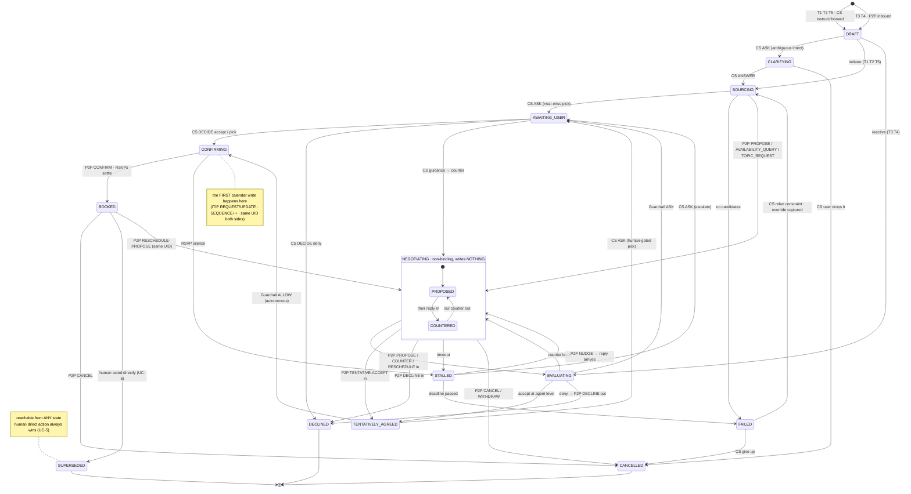
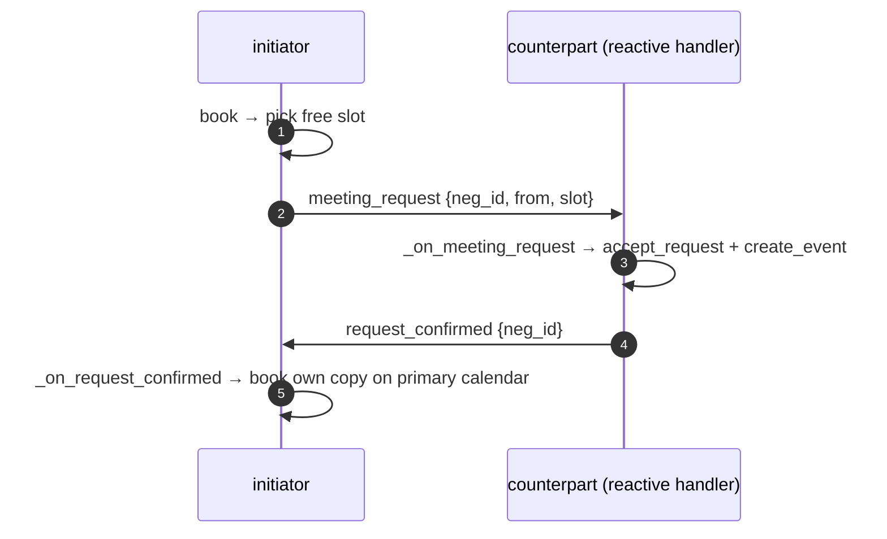

# Parley Communication Protocol — Design

> *What* we're building: per-user agents that negotiate meetings, semi-autonomously and
> privately (see [`intuition.md`](../../vision/intuition.md)). This doc
> defines *how* two Parley agents talk to each other over email — and hosts the
> **end-to-end state machine** (§4) that spans both channels (User ↔ Agent ↔ Other).
>
> Status: **design / partly landed.** Parts of this target have since shipped and are the
> **as-built** in [`agent-architecture.md`](agent-architecture.md): the four peer verbs are
> the model's `send` tool (OFFER/ACCEPT/DECLINE/CANCEL), the binding write is `apply`, the
> machine payload moved off the visible body into a hidden `<!-- PARLEY -->` HTML comment
> (§6), and thread-based correlation + the stall-nudge timer + override capture all run.
> Still **target, not built:** UID-keyed identity as the single `ref` (§2–§3), the explicit
> `phase` write-boundary (today `apply` can still run mid-exchange), and the iCalendar
> `X-PARLEY-*` sidecar (§6). The compressed 4-state machine is
> [`communication-protocol-future-development.md`](../../iterations/communication-protocol-future-development.md).

---

## 0. Why this doc exists

The toy's first real-account run surfaced the failure that motivated this design:

```
[outlook] 📩 gmail asks to move 'meeting: gmail-outlook': 14:00–15:00 → 15:00–16:00
[outlook] 🤷 can't find that meeting — declining.
```

Outlook declined because it tried to *re-derive* the meeting's identity from Microsoft
Graph's attendee model (`find_event(attendee, slot)`), and Graph excludes the organizer
from the attendee list — so the lookup failed. The root cause isn't a one-line bug; it's
that the protocol had **no stable notion of "which object are we talking about."** This
spec fixes that class of problem.

---

## 1. The organizing principle: object continuity

A meeting is a single durable **object** with a stable identity. Every message — whoever
starts it, however it's serialized — is an *operation on that object*, never a new
parallel thing.

- The negotiation is a sequence of proposed edits to **one** object's state.
- The entry point may be an iCalendar invite **or** a plain email. Once an object exists,
  every later message carries its identity and prefers the same representation.
- Rescheduling an existing meeting operates on the **existing** object (its existing
  UID). We never mint a second object for a meeting that already exists.

Everything below is a consequence of taking this principle seriously.

---

## 2. Identity: `iCalUID` is the keystone

The canonical identity of a meeting is its **iCalendar UID**, which both backends already
expose and which is **consistent across providers and across attendees' copies**:

- Microsoft Graph: `event.iCalUId`
- Google Calendar: `event.iCalUID`

A meeting created in Google and accepted in Outlook carries the *same* UID on both sides,
because the UID travels inside the invite and both providers honor it.

| Situation | How identity is obtained |
|---|---|
| Existing meeting (already on a calendar) | read `iCalUID` from the provider |
| Parley-originated meeting | mint `parley-<rand>@<domain>` and set it on creation |

**Consequence — the original bug is designed out.** `find_event` resolves by **UID**, not
by guessing from a provider's attendee model. Identity is *carried*, never *re-derived*.

---

## 3. The front door: identity resolution

Every inbound message passes through one resolver before any other handling:

1. **Message carries a UID** (iCalendar `UID` or `X-PARLEY-UID` sidecar) → load that
   object's negotiation state.
2. **No UID, but about an existing meeting** (a reschedule) → resolve once by UID/time
   lookup, then **attach the UID to all replies** so identity is healed and never lost
   again.
3. **No UID, genuinely new** → mint a UID, create a *tentative* draft object.

After this step, the rest of the code always operates on a known object.

---

## 4. The end-to-end state machine (keyed on UID)

> This section spans **both** channels: every transition is labeled `CS` (client-server,
> human ↔ own agent) or `P2P` (peer-to-peer, agent ↔ counterpart). The two wire *specs*
> stay separate (§10 / [`client-server.md`](client-server.md)); this machine is the one
> artifact that shows them together.
>
> This is the **normative catalogue** — complete by enumeration. A compressed target
> (4 states × attributes, 4 peer verbs) is explored in
> [`communication-protocol-future-development.md`](../../iterations/communication-protocol-future-development.md).

### 4.1 Entities & channels

| Entity | Who | Talks to the Agent via | Channel |
|---|---|---|---|
| **User** | the Parley user | Parley CLI · Desktop client (tray) | client-server |
| **Agent** | the user's Parley agent | — (it *is* the machine) | — |
| **Other** | counterpart(s): a Parley agent **or** a plain human, **1..N** | email: PARLEY block · native invite · prose | peer-to-peer |

Multi-party (Other = many, [UC-2](../use-cases/use-cases.md#uc-2--multi-party-convergence)):
one negotiation object, one **per-counterpart track** each walking `NEGOTIATING`; all tracks
must agree before the object reaches `TENTATIVELY_AGREED`.

### 4.2 Entry points — how a negotiation object is born

Every entry passes the identity front door (§3) first, then:

| # | Trigger | Source (channel) | Path through the machine |
|---|---|---|---|
| T1 | **Specific instruction** — `book with x@y.com at HH:MM topic T` | User (CS) | fully constrained: `SOURCING` is a self-check only → `PROPOSE` the given slot |
| T2 | **Broad instruction** — `book before HH:MM` / `book between …` | User (CS) | `SOURCING` branches on **counterpart visibility** (below) |
| T3 | **Inbound meeting request** — PARLEY block or native invite | Other (P2P) | `EVALUATING` → Guardrail ALLOW / ASK / DENY; ASK → `AWAITING_USER` |
| T4 | **Inbound plain email** about a meeting | Other (P2P) | Gateway → the Brain comprehends → `EVALUATING` (same gate) |
| T5 | **User forwards / mentions** an inbound item to their own agent (via a client), optionally with reschedule constraints | User (CS) | adopt the **existing** object (same UID, §1) → `CLARIFYING` or straight to `SOURCING` / `NEGOTIATING` |
| T6 | **Calendar change watch** — the human acted directly ([UC-5](../use-cases/use-cases.md#uc-5--the-human-steps-in-mid-negotiation)) | calendar feed | reconcile → `SUPERSEDED` (or restart) — *deferred; named so the machine is complete* |

**Counterpart visibility — the T2 branch:**

| Visibility | Meaning | `SOURCING` behaviour |
|---|---|---|
| `VISIBLE` | the Agent can read the counterpart's free/busy (corporate-style colleague availability) | **future work**: pick a common open slot → `PROPOSE`; if none exists → `AWAITING_USER` with the nearest near-miss slots, or open a displacement ask (UC-3/UC-4) |
| `NONE` | no access — today: always | ask over email per policy: `AVAILABILITY_QUERY` (ask for their slots) or `PROPOSE` (offer ours) |

### 4.3 State catalogue

Phases keep the founding invariant: **negotiate = non-binding (writes nothing) · commit = binding**.

| State | Phase | Meaning | Waiting on | Exits |
|---|---|---|---|---|
| `DRAFT` | intake | identity resolved (§3), object minted, intent comprehended | — (transient) | `CLARIFYING` · `SOURCING` (T1/T2/T5) · `EVALUATING` (T3/T4) |
| `CLARIFYING` | intake | Agent lacks info to proceed; asked its User (`ASK`: clarification) | User | `SOURCING` · `CANCELLED` |
| `SOURCING` | negotiate | availability check: own free/busy **union** + counterpart-visibility branch (§4.2) | — (transient) | `NEGOTIATING` · `AWAITING_USER` (near-miss pick) · `FAILED` |
| `EVALUATING` | negotiate | an inbound `PROPOSE` / `COUNTER` / `RESCHEDULE-PROPOSE` under decision: policy + Guardrail | — (transient) | `TENTATIVELY_AGREED` (accept) · `NEGOTIATING` (counter) · `AWAITING_USER` (ASK) · `DECLINED` (deny) |
| `NEGOTIATING` | negotiate | the non-binding propose↔counter loop; substates `PROPOSED` (our message out) / `COUNTERED` (their reply in → `EVALUATING`) | Other | `EVALUATING` · `TENTATIVELY_AGREED` · `DECLINED` · `STALLED` · `CANCELLED` |
| `AWAITING_USER` | gate | parked at the human gate (`Agent.awaiting[neg_id]`): approve inbound · pick from ranked slots · give guidance | User | `CONFIRMING` · `NEGOTIATING` (guidance) · `DECLINED` · `CANCELLED` |
| `TENTATIVELY_AGREED` | negotiate | slot agreed **agent-to-agent**; still nothing on any calendar | policy | `AWAITING_USER` (human-gated) · `CONFIRMING` (Guardrail ALLOW) |
| `CONFIRMING` | commit | binding commit in flight: `CONFIRM` (iTIP REQUEST/UPDATE, `SEQUENCE++`), **first calendar write**, RSVPs settling | Other (RSVP) | `BOOKED` · `STALLED` |
| `BOOKED` | done | on the calendars, RSVPs settled | — (at rest) | `NEGOTIATING` (reschedule, **same UID**) · `CANCELLED` · `SUPERSEDED` |
| `STALLED` | negotiate | counterpart silent past timeout | Other / User | `NEGOTIATING` (`NUDGE` → reply) · `AWAITING_USER` (escalate) · `FAILED` (deadline) · `CANCELLED` |
| `FAILED` | gate | no solution before the deadline ([UC-4](../use-cases/use-cases.md#uc-4--no-solution-exists)): `REPORT` nearest alternatives + trade-offs | User | `SOURCING` (User relaxes a constraint — **override captured**) · `CANCELLED` |
| `DECLINED` | terminal | Other said no; policy/User chose not to renegotiate | — | (a reopen is a new negotiation on the same UID) |
| `CANCELLED` | terminal | binding `CANCEL` either direction, or the initiator withdrew | — | — |
| `SUPERSEDED` | terminal | the human acted directly (UC-5): manual accept / move / cancel outranks the agent; **override captured** | — | — |

Invariants (straight from the brief):

- **No calendar write before `CONFIRMING`.** A meeting under reschedule **keeps its current
  time** throughout `NEGOTIATING` — proposed times live only in negotiation state. *(Behavior
  change from the current toy, where `_on_proposal` calls `move_event` mid-negotiation.)*
- **Updates are ordered** by iCalendar `SEQUENCE`: higher wins, ties broken by timestamp —
  concurrent reschedules of one object are well-defined, not racy.
- **`SUPERSEDED` is reachable from any state** — a direct human action always wins (UC-5).
- **Every transition is journaled** (message + decision). An out-of-state message is journaled
  and escalated or ignored — never dropped silently (iteration 10).

### 4.4 Diagram



### 4.5 Action typology — what the Agent can do

Every transition above is driven by one of these. Account-bound actions take an explicit
`conn` and pass the Guardrail (see [agent-architecture §ToolBelt](agent-architecture.md)).

| Action | Kind | Drives | Today |
|---|---|---|---|
| `resolve_contact` — account lookup, name → address | read | `DRAFT` / `SOURCING` | ✅ |
| `check_availability` — own free/busy union | read | `SOURCING` | ✅ |
| `check_counterpart_availability` — the `VISIBLE` branch (§4.2) | read | `SOURCING` | ⬜ future |
| `rank_slots` — order candidates for the wire / the User | read | `SOURCING` | 🟡 (first-free only) |
| `send(verb)` — the one peer tool, verbs OFFER/ACCEPT/DECLINE/CANCEL/TEXT (§5.1) | gated | `NEGOTIATING` ↔ | ✅ (the 8-tool `send`, iter 21) |
| `ask_user` — approval · ranked pick · clarification · guidance | CS | `CLARIFYING` · `AWAITING_USER` | ✅ |
| `report_user` — booked · failed + alternatives · status | CS | `BOOKED` · `FAILED` | 🟡 |
| `apply(create)` — **the binding write** (books as asker, RSVPs as answerer) | binding | `CONFIRMING` | ✅ (the 8-tool `apply`, iter 21) |
| `apply(move)` / `apply(cancel)` | binding | reschedule commit / `CANCELLED` | ✅ |
| auto-RSVP of settled invites | infra (binding) | `CONFIRMING` → `BOOKED` | ✅ (iter 11) |
| `schedule_nudge` — timeout timer | infra | `STALLED` | ✅ (stall timer, iter 21) |
| `journal` — every message + decision | infra | all states | ✅ (iter 10) |
| `capture_override` — human pick ≠ agent rank → training data | infra | `AWAITING_USER` · `FAILED` · `SUPERSEDED` | ✅ ((offered,chosen) pairs journaled, iter 21) |
| `spawn_sub_negotiation` — displacement cascade | — | [UC-3](../use-cases/use-cases.md#uc-3--no-open-slot-exists--displacement-cascade--the-wedge) | ⬜ deferred |

---

## 5. Message typology

### 5.1 Peer-to-peer (Agent ↔ Other)

Mapped onto the standard calendar-scheduling protocol (iTIP, RFC 5546) wherever possible,
so a human — or an agentless counterpart — sees native accept/decline cards.

| Parley type | Phase | iTIP method | Binding? | Carries |
|---|---|---|---|---|
| `TOPIC_REQUEST` | negotiate | — (prose + sidecar) | no | willingness ask — "meet to discuss T?", no slots yet |
| `AVAILABILITY_QUERY` | negotiate | — (prose + sidecar) | no | a constraint window ("before Friday"); asks for candidate slots without proposing any |
| `PROPOSE` | negotiate | `REQUEST` (tentative) | no | ranked candidate slots |
| `COUNTER` | negotiate | `COUNTER` | no | alternative slot(s) |
| `TENTATIVE-ACCEPT` | negotiate | `REPLY` (TENTATIVE) | no | the slot agreed *at agent level* |
| `DECLINE` | negotiate | `REPLY` (DECLINED) / `DECLINECOUNTER` | no | reason |
| `WITHDRAW` | negotiate | — (sidecar) | no | retracts our own still-unanswered proposal |
| `NUDGE` | negotiate | — (prose + sidecar) | no | timeout reminder; echoes the pending proposal |
| `RESCHEDULE-PROPOSE` | negotiate | `COUNTER` on the existing UID | no | new candidate slots for an **existing** meeting (same UID, §1) |
| `CONFIRM` | commit | `REQUEST` / UPDATE, `SEQUENCE++` | **yes** | the chosen slot |
| `CANCEL` | either | `CANCEL` | **yes** | — |
| native `RSVP` | commit | `REPLY` (ACCEPTED / DECLINED) | **yes** | an agentless counterpart's answer to a real invite (§7) |
| free-text prose | any | — | no | anything a human writes; the brain maps it onto one of the above |

### 5.2 Client-server (User ↔ Agent)

Wire spec: [`client-server.md`](client-server.md). Listed here only as state-machine inputs/outputs.

| Message | Direction | Carries |
|---|---|---|
| `INSTRUCT` | User → Agent | **specific** (`with x@y.com at HH:MM topic T`) or **broad** (`before HH:MM` / `between …`) |
| `FORWARD` | User → Agent | an inbound invite/email handed to the agent (T5), optionally with reschedule constraints |
| `ASK` | Agent → User | approval · ranked-slot pick · clarification · guidance (correlated by `ref:question_id`) |
| `DECIDE` / `ANSWER` | User → Agent | the verdict / the info, correlated by `ref` |
| `REPORT` | Agent → User | booked · failed + nearest alternatives + trade-offs · status |

### 5.3 Message × state validity

What may legally arrive in which state, and what it does. Anything outside this table is
**journaled + escalated-or-ignored — never a silent drop**.

| Inbound | Legal in | Effect |
|---|---|---|
| `PROPOSE` (new UID) | — (creates the object) | → `DRAFT` → `EVALUATING` (T3) |
| `TOPIC_REQUEST` / `AVAILABILITY_QUERY` | — (creates) · `NEGOTIATING` | → `EVALUATING`: answer willingness / offer candidate slots |
| `COUNTER` | `NEGOTIATING` (`PROPOSED`) | → `EVALUATING` |
| `TENTATIVE-ACCEPT` | `NEGOTIATING` | → `TENTATIVELY_AGREED` |
| `DECLINE` | `NEGOTIATING` · `CONFIRMING` | → `DECLINED` (or back to `SOURCING` if other candidates remain) |
| `CONFIRM` | `TENTATIVELY_AGREED` · `NEGOTIATING` | counterpart committed → `CONFIRMING`: write own copy → `BOOKED` |
| `RESCHEDULE-PROPOSE` | `BOOKED` | re-enter `NEGOTIATING` on the **same UID** |
| `CANCEL` | any non-terminal | → `CANCELLED` |
| `WITHDRAW` | `EVALUATING` · `AWAITING_USER` (their proposal pending on us) | drop their proposal → back to `NEGOTIATING` (or `CANCELLED` if nothing left) |
| `NUDGE` | any state where the ball is ours | re-surface: answer, or escalate to the User |
| native `RSVP` | `CONFIRMING` | settle → `BOOKED` (accept) or `DECLINED` |
| free-text prose | any | the brain interprets → one of the rows above |
| `INSTRUCT` / `FORWARD` (CS) | — (creates / adopts) | → `DRAFT` (T1/T2/T5) |
| `DECIDE` / `ANSWER` (CS) | `AWAITING_USER` · `CLARIFYING` | resume per §4.3 exits |
| human calendar action (T6) | any | → `SUPERSEDED` — override captured |

---

## 6. Serialization (the hybrid, made precise)

The transport is the user's real mailbox, so **a human is inside the channel** — they may
read, reply to, or even edit these messages. Three layers per message:

1. **Human-readable prose** in the body — always carries the full meaning, so a human
   reader/replier is never lost and an agentless recipient can still act.
2. **The meeting object** — if the message maps to an iTIP method, send it as a real
   iCalendar object (`REQUEST`/`REPLY`/`COUNTER`/`DECLINECOUNTER`/`CANCEL`). Same object,
   native card, works even if the other side has no agent.
3. **The Parley sidecar** — for what iTIP can't express. **As-built (human-readable
   messaging, 2026-07-22):** carried in a hidden **HTML comment**
   `<!-- PARLEY {json} -->` in the `text/html` part — the one carrier that survives all
   four backends (Gmail's text-only fetch, Graph, Yahoo IMAP/SMTP, classic-Outlook COM),
   invisible to a human reading the prose. The **target** remains iCalendar `X-PARLEY-*`
   properties on the object (travels with the object, rendered as a card) once per-provider
   property survival is verified. The legacy body `-----BEGIN/END PARLEY-----` block is now
   **parsed inbound for back-compat but never emitted** — no longer the source of truth.

> **Where machine data must NOT live:** free-floating in the visible body where a human
> edits it. The hidden HTML comment already moved it out of the human-editable prose; the
> iCal sidecar would harden it further (travels with the object, not just the mail).

### Sidecar fields (minimum)

| Field | Purpose |
|---|---|
| `protocol_version` | forward/backward compatibility |
| `negotiation_id` | stable for the *whole* exchange (not regenerated per message) |
| `meeting_uid` | the object identity (§2) |
| `message_type` | one of §5 |
| `phase` / `binding` | negotiate vs commit; whether this mutates a calendar |
| `in_reply_to` | correlation independent of flaky email threading |
| `candidate_slots` | **ranked** list of offered slots |
| `ranking` | the agent's explicit ordering — see below |

### Brief alignment, by construction

- **Information-minimized exchange:** `candidate_slots` reveals only the slots an agent
  will *offer*, never its full calendar. Privacy holds without extra machinery.
- **Override-as-training-data:** because the agent's `ranking` is explicit on the wire,
  the signal is computable as *(human's pick) − (agent's rank)*. No flow discards it.
- **A2A north star:** §4–§6 separate the *protocol* (message semantics, state machine)
  from the *transport* (email serialization). The protocol is A2A-shaped, so it can later
  move onto real A2A/HTTP without redesign — email is just today's serialization.

---

## 7. Graceful degradation (no agent on the other side)

Not everyone runs Parley. The first message to a counterpart must be valid as an ordinary
invite:

- a real calendar invite the human can accept/decline natively, **plus**
- prose carrying the full meaning, **plus**
- the sidecar (silently ignored by humans and agentless clients).

If no agent ever replies, the human handles it manually and the override/manual path still
works.

---

## 8. Open sub-decisions

These are deliberately unresolved; they change the message schema and belong in a follow-up
reasoning pass.

1. **Ranked candidates vs. iTIP ping-pong.** Send all 2–3 candidates up front in the
   sidecar (one round trip, richer), or stay strict one-`COUNTER`-at-a-time (simpler, more
   native, more round trips)? *Recommendation: front-load candidates in the sidecar — it
   directly serves the brief's "surface 2–3 ranked slots" and minimizes round trips.*
2. **Authenticity** (brief §5, identity/auth between agents). Sidecar tampering is trivial
   today; human-gating is the MVP safety net. Add an HMAC/signature now, or defer?
   *Recommendation: defer hard crypto for MVP, but reserve a `signature` sidecar field so
   adding it later is non-breaking.*
3. **UID minting authority** when *both* agents originate Parley meetings — whose UID wins,
   and how do we avoid two UIDs for one intended meeting? *Recommendation: the initiating
   (PROPOSE) agent mints; the responder always echoes that UID.*

---

## 9. Implications for the current code

What this spec asks the agent (`parley/agent/`) and the providers to change (status as of
iteration 21 + human-readable messaging):

- Resolve meetings by **UID**, not `find_event(attendee, slot)` — fixes the §0 decline.
  🟡 **partly:** invite ids now prefer iCalUID (`mtg-i<hash(iCalUID)>`), and `move`/`delete`
  target by title+attendee not slot alone; a full UID front door is still pending.
- Add an **identity-resolution front door** (§3) ahead of dispatch. ⬜ pending.
- Add an explicit **`phase`** and stop writing calendars during negotiation (§4) — only
  the commit mutates. 🟡 **partly:** the surface now separates `send` (never writes) from
  `apply` (the only writer); an explicit per-negotiation `phase` guard is still pending.
- Make `negotiation_id` stable across the whole exchange. ✅ **done** (iteration 21 "one
  ref": `mtg-` ids, uid-keyed invite aliases, `#N` epochs for reopens).
- Move the sidecar off the free-text body toward a tamper-resistant carrier (§6).
  🟡 **partly:** now a hidden HTML comment (off the human-editable prose); the iCal
  `X-PARLEY-*` form is the remaining target.

---

## 10. Two channels: two wires, one state machine

This document specifies the **peer-to-peer** wire (agent ↔ agent). The **client-server** channel
(human ↔ their own server: `instruct`, status, decisions) is a *separate*
protocol — see `client-server.md`. The wires never mix; the **state machine in §4 is the
one artifact that shows both** (every transition labeled `CS` or `P2P`):

- a human's `instruct` enters via the client-server channel (HTTP) and produces, at most,
  one peer-to-peer `meeting_request`;
- a self-addressed instruction email (`From == own address`, subject `parley`, **no**
  PARLEY block) is client-server, not a negotiation message — `Agent.handle()` routes it
  before peer-to-peer handling.

---

## 11. Initiator (`book`) flow — addition to the current ad-hoc protocol

The toy was reactive only; a meeting object only ever originated from an *inbound*
human invite. The `book` use case ([UC-0a](../use-cases/supported-use-cases.md#uc-0a--autonomous-booking-no-human-gate))
lets the **agent originate** one. In the current ad-hoc JSON protocol (not yet the
iCalUID target above) this needs two small, backward-compatible field additions:

| Message | Field added | Why |
|---|---|---|
| `meeting_request` (agent-originated) | `negotiation_id` (minted by initiator), `from` (initiator address) | so the initiator can correlate the eventual confirmation |
| `request_confirmed` (reply) | echo `negotiation_id` | initiator matches the confirmation to its pending book and books its own copy |

Flow:



- Both fields are **optional/ignored** by the old reactive path, so the yahoo→gmail
  toy keeps working unchanged (backward compatibility).
- This is a temporary shim under the current protocol; it folds into the §3 identity
  front door and §4 phase split when those land (the `negotiation_id` here is the same
  one §6 requires to be stable across the exchange).
- In §4.3 terms the shim walks: `SOURCING` → `NEGOTIATING (PROPOSED)` → `CONFIRMING` →
  `BOOKED` — skipping the gate states, which is exactly what makes it UC-0a (no human gate).

