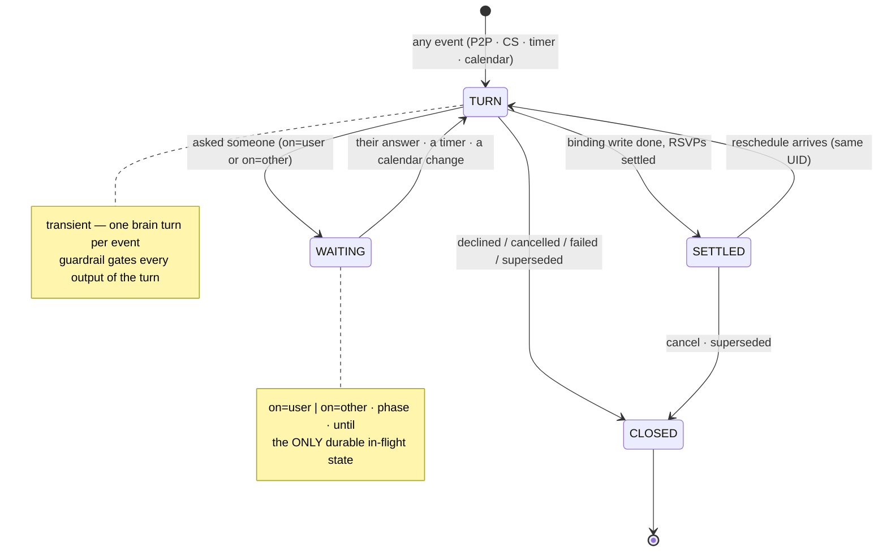

# Communication Protocol — Future Development: the compact machine

> **Snapshot (written iter 12; status refreshed 2026-07-24).** A point-in-time planning
> record, not current direction. **Shipped since (now as-built in
> [`communication-protocol.md`](../design/architecture/communication-protocol.md)):** the
> four peer verbs are the model's `send` tool, the binding write is `apply`, S1 one `ref`
> (`mtg-` ids + epochs), and the machine payload rides a hidden `<!-- PARLEY -->` HTML
> comment (§9 here). **Still target:** the full compact 4-state machine, UID-as-`ref`
> identity front door, the explicit `binding`/`phase` write-boundary, and the iCal
> `X-PARLEY-*` sidecar. Deep per-section trimming still owed (iteration-20 open-task #4).
>
> Companion to [`communication-protocol.md`](../design/architecture/communication-protocol.md). That doc is the
> **normative catalogue** — 14 states, ~18 message types, 14 actions, complete by
> enumeration. This doc explores the same behavior **compressed**: fewer primitives that
> capture more, for the next protocol/code generation. **Part I** (§1–§7) is the compact
> machine; **Part II** (§8–§12) is the wider protocol/wire simplification survey. The
> architecture-side survey (permissions, trust, runtime, surfaces) is
> [`agent-architecture-future-development.md`](agent-architecture-future-development.md),
> which also holds the joint **sequencing table** and the **what-not-to-simplify** list.
>
> Status: **exploration / target.** The compact machine itself is not implemented; the
> catalogue stays authoritative until a wire v2 lands. Nothing here *removes* behavior —
> §5 proves it by mapping every catalogue item onto a compact primitive.
>
> **As-built precursors (iteration 20, in progress):** two ideas from this doc now exist
> ahead of the full machine — (a) a plain "Declined:" notification is recognized as a
> **`DECLINE`** even without an iCal REPLY (§3's verb + §13's prose fallback), correlated
> by (peer, topic); and (b) when no time is fixed and a peer's free/busy isn't visible
> (`check(who)`→ not accessible, §12), the agent emails for availability — a prose
> **`OFFER{window}`** (§3). Steps toward the machine, not the machine: the four-verb wire
> and the one `ref` still remain unbuilt.

---

## 1. The observation

Most of the catalogue's states are **one concept crossed with another**:

- `CLARIFYING` vs `AWAITING_USER` — both "waiting on the User"; only the *question kind* differs.
- `NEGOTIATING(PROPOSED)` vs `STALLED` vs `CONFIRMING` — all "waiting on Other"; only the
  *phase* and *a timer* differ.
- `DRAFT`, `SOURCING`, `EVALUATING`, `TENTATIVELY_AGREED` — all transient "the agent is
  thinking"; they are *moments inside one brain turn*, not durable states.
- `DECLINED`, `CANCELLED`, `FAILED`, `SUPERSEDED` — all "closed"; only the *outcome* differs.

So the machine is really **three orthogonal attributes** wearing 14 costumes:

| Attribute | Values |
|---|---|
| `ball` — whose input unblocks us | `user` · `other` · nobody (agent's turn) |
| `phase` — the binding boundary | `negotiate` (writes nothing) · `commit` (binding) |
| `outcome` — only when closed | `booked` · `declined` · `cancelled` · `failed` · `superseded` |

This matches what the code already became in iteration 08: **one brain, one turn per
event**; the only durable state the agent keeps is *working memory + who it's waiting on*.
The 14-state catalogue is the spec-level elaboration of a much smaller run-time machine.

---

## 2. The compact machine — 4 states

Everything is: **event → one brain turn → (wait | settle | close)**.

| State | Meaning | Attributes carried |
|---|---|---|
| `TURN` | the brain is acting on an event (comprehend, source, evaluate, decide) — transient, never persisted across a poll | — |
| `WAITING` | parked until someone answers | `on: user\|other` · `phase` · `until: deadline/timer` · the pending question/proposal |
| `SETTLED` | booked, at rest; reopenable on the **same UID** | — |
| `CLOSED` | over | `outcome` |

**Events** (all of them — each wakes exactly one `TURN`):

| Event | Channel | Today's name |
|---|---|---|
| peer message in | P2P | T3/T4, replies, RSVPs |
| user message in | CS | T1/T2/T5, `DECIDE`/`ANSWER` |
| timer fires | infra | `STALLED`, nudge, deadline |
| calendar changed externally | infra | T6 / UC-5 (`SUPERSEDED`) |

Invariants survive intact, now attached to attributes instead of state names:

- **No calendar write while `phase=negotiate`** — the binding boundary is the `phase`
  flip, gated by the Guardrail, exactly as before. *(This constrains negotiation, not
  direct bookings: a fully-specified instruction — "book with x@y at HH:MM" — has
  nothing to negotiate; the user's words are the commitment, so that turn enters at
  `phase=commit` and writes the event + sends the invite immediately. The rule is
  "proposals never mutate", and a meeting under reschedule keeps its current time
  until commit.)*
- **Human wins:** the calendar-changed event closes with `outcome=superseded` from any
  state — one rule instead of a special state reachable from 14 places.
- **Every event and every turn output is journaled** — observability moves from state
  names to logged attributes (the journal already records kind + payload, iter 10).

---

## 3. Messages — 4 peer verbs

Every peer message is an **operation on the meeting object**. Four verbs, richness in the
payload:

| Verb | Payload | Covers (catalogue names) |
|---|---|---|
| `OFFER` | `slots[0..n]` (ranked) · `window?` · `topic` · `uid` | `PROPOSE` (n≥1) · `COUNTER` (n≥1, in reply) · `RESCHEDULE-PROPOSE` (n≥1, existing UID) · `AVAILABILITY_QUERY` (**n=0** + window) · `TOPIC_REQUEST` (**n=0**, topic only) · `NUDGE` (idempotent re-send, same `negotiation_id`) |
| `ACCEPT` | `slot` · `binding: bool` | `TENTATIVE-ACCEPT` (false) · `CONFIRM` (true) · native RSVP-accept (true) |
| `DECLINE` | `reason?` · `binding: bool` | negotiate decline / `DECLINECOUNTER` (false) · native RSVP-decline (true) |
| `CANCEL` | `scope: proposal\|meeting` | `WITHDRAW` (proposal, non-binding) · `CANCEL` (meeting, binding) |

Free-text prose remains the fallback: the brain reads it and maps it onto one verb.

iTIP mapping collapses accordingly:

| Verb | iTIP |
|---|---|
| `OFFER` | `REQUEST` (tentative) / `COUNTER`; n=0 forms are prose + sidecar only |
| `ACCEPT` | `REPLY` TENTATIVE (non-binding) / `REQUEST`+`SEQUENCE++` or `REPLY` ACCEPTED (binding) |
| `DECLINE` | `REPLY` DECLINED / `DECLINECOUNTER` |
| `CANCEL` | `CANCEL` (meeting scope); proposal scope is sidecar-only |

`binding` on the wire **is** the phase flip — the receiver never infers the negotiate/commit
boundary from message *names*.

## 3b. Client-server — 3 verbs

The code is already here: `/v1/instruct` takes `{text}`, `/v1/decide` takes free-text
guidance. Name it:

| Verb | Direction | Covers |
|---|---|---|
| `SAY` | User → Agent | `INSTRUCT` (specific/broad) · `FORWARD` (T5) · `DECIDE`/`ANSWER` (with `ref`) |
| `ASK` | Agent → User | approval · ranked pick · clarification · guidance (with `ref`) |
| `TELL` | Agent → User | `REPORT`: booked · failed + alternatives · status |

---

## 4. Actions — ~6 tools + infra

The brain's tool surface shrinks to composable primitives; cross-cutting concerns stay
**infra-owned** (the iteration 09/10 precedent: tz, idempotency, journal are not tools).

| Tool | Kind | Absorbs (catalogue actions) |
|---|---|---|
| `lookup(name)` | read | `resolve_contact` |
| `check(window, who?)` | read | `check_availability` · `check_counterpart_availability` (the `who` argument is the visibility branch) · `rank_slots` (returns ranked) |
| `send(verb, payload)` | gated | `send_peer_message` — one tool, four verbs (§3) |
| `apply(change)` | **binding** | `create_event` (book / RSVP) · `move_event` · `delete_event` · auto-RSVP — one calendar-write tool, one guardrail choke point |
| `ask_user(question)` | CS | `ask_user` (all four question kinds) |
| `tell_user(report)` | CS | `report_user` |
| — infra, not tools — | | `journal` · `schedule_nudge` (a timer the infra sets when a turn ends in `WAITING`) · `capture_override` (infra diffs human answer vs agent rank) · tz · idempotency |

`spawn_sub_negotiation` (UC-3) stays deferred — in the compact model it is just a new
object whose `OFFER` carries `conditional: true`, plus a parent→child link in memory.

---

## 5. Mapping — nothing is lost

| Catalogue (14 states) | Compact |
|---|---|
| `DRAFT` · `SOURCING` · `EVALUATING` · `TENTATIVELY_AGREED` | moments inside `TURN` |
| `CLARIFYING` | `WAITING{on=user}` (question kind = clarification) |
| `AWAITING_USER` | `WAITING{on=user}` (approval / pick / guidance) |
| `NEGOTIATING (PROPOSED)` | `WAITING{on=other, phase=negotiate}` |
| `NEGOTIATING (COUNTERED)` | the reply event → `TURN` |
| `STALLED` | `WAITING{on=other}` + timer fired (an **event**, not a state) |
| `CONFIRMING` | `WAITING{on=other, phase=commit}` |
| `BOOKED` | `SETTLED` |
| `FAILED` | `CLOSED{outcome=failed}`; user's relax-constraint `SAY` is a new event on the same object |
| `DECLINED` / `CANCELLED` / `SUPERSEDED` | `CLOSED{outcome=…}` |

The §5.3 validity matrix collapses to one rule: **any event wakes a turn on its object;
the brain decides; the Guardrail gates the turn's outputs; out-of-context events are
journaled and answered or escalated.** Validity becomes the brain's judgment bounded by
the guardrail — which is the iteration-08 philosophy applied to the protocol itself.

---

## 6. What it buys, what it costs

| Buys | Costs |
|---|---|
| the run-time model matches the code (brain + `awaiting` + memory) — states can't drift from implementation | the catalogue remains necessary as the **normative behavior spec** (tests, interop) — two views to keep mapped |
| 4 wire verbs to keep interoperable instead of ~13 types | observability relies on journaled attributes, not state names (already true since iter 10) |
| smaller brain prompt: verbs + attributes, not a state × message matrix | `binding` and `scope` flags become load-bearing — need explicit wire validation |
| new capabilities land as **payload fields**, not new states/messages (e.g. UC-3 `conditional: true` on `OFFER`) | a human reading one email sees less variety of message names (mitigated: prose layer carries meaning, §6 of the protocol doc) |

## 7. Migration sketch (when wire v2 happens)

1. Add `verb` + attribute fields to the sidecar alongside today's `type` (old types map
   1:1 — the §5 table *is* the compatibility shim).
2. Fold the ToolBelt into the §4 surface (`send`, `apply` as the two gated/binding choke
   points); infra takes timers + override capture.
3. Re-derive the catalogue doc's §4/§5 as a **view** over this model; keep the mapping
   table under test (each catalogue transition = one compact event+attribute tuple).

---

# Part II — the wider protocol/wire survey

Every candidate simplification of the wire itself, each as **Today → Simplify to →
Buys / Risk**. Sequencing (which wave each lands in) is the
[joint table](agent-architecture-future-development.md#sequencing--the-waves).

## 8. S1 — One correlation id

**Today** four identities correlate things: `negotiation_id` (the exchange; minted
uuid or deterministic `inv-<hash(organizer|slot)>`), `iCalUID` / `meeting_uid` (the
target object identity, catalogue §2 — not yet in code), `ref` / `question_id` (a
client-server ask), and email threading / `in_reply_to`. The §0 decline bug — identity
*re-derived* instead of carried — is exactly what happens when ids multiply.

**Simplify to** one `ref`: **the meeting object's UID**, plus an epoch suffix for
reopens (`uid#2` = the second negotiation about the same object). Peer messages carry
it; a client-server ask about a negotiation carries the *same* ref; the journal keys on
it. `negotiation_id` and `question_id` disappear as separate concepts.

- **Buys:** the whole id-mapping bug class gone; `grep <ref> journal-*.jsonl` shows one
  meeting's entire life across both channels; memory, awaiting, and the wire share one
  key.
- **Risk:** UID-minting authority becomes load-bearing (catalogue §8.3): the initiator
  mints, the responder **always echoes** — two agents initiating simultaneously need
  the tie-break rule up front. Free-standing questions (no meeting yet) still need a
  ref of their own (mint a UID early: the *draft* object is the meeting).

## 9. S2 — One machine serialization

**Today** three machine layers coexist in design: the `-----BEGIN PARLEY-----` body
block (running code — free-floating text a human can clobber), a real iCalendar object
(invites), and the target `X-PARLEY-*` sidecar properties (§6) — with the body block
"retained as a transitional/debug fallback".

**Simplify to** exactly two layers per message: **prose** (always carries the full
meaning for humans and agentless counterparts) + **one machine layer** — the iCalendar
object with `X-PARLEY-*` properties when an event payload exists, `X-Parley-*` *email
headers* for event-less messages (a slots=0 `OFFER`, a `NUDGE`). The body block dies;
there is **one** fallback (headers), not three.

- **Buys:** one parser + one emitter; machine data leaves the human-editable body
  (tamper-resistance by default); graceful degradation unchanged (prose + native
  invite still do the work).
- **Risk:** some providers strip or reorder custom headers — must be verified per
  backend (Gmail, Graph, Yahoo SMTP) *before* the body block is removed, not after.

## 10. S3 — Verbs + attributes are the versioning story

**Today** evolution means new message *types* (the catalogue grew `NUDGE`, `WITHDRAW`,
`AVAILABILITY_QUERY`…), and compatibility means a `protocol_version` field nobody
branches on yet.

**Simplify to** the four §3 verbs as a **closed set**; everything new lands as a
**payload attribute** (`conditional: true` for UC-3 candidates, `scope` for recurrence,
`window` for queries). An unknown *attribute* is ignorable; an unknown *type* is not —
so the wire stays forward-compatible by construction. `protocol_version` stays, but
only gates attribute semantics, never the verb set.

- **Buys:** old agents interoperate with new features (they see a valid `OFFER`, minus
  the nuance); the §5 mapping table is the one-time compat shim from today's `type`s.
- **Risk:** attribute soup — needs a registry section in the spec (name, semantics,
  since-version) so attributes don't accrete undocumented.

## 11. S10 — One negotiation primitive; use cases are payload shapes

**Today** the use-case catalogue treats booking (UC-0/0a), rescheduling (UC-1),
multi-party (UC-2) and displacement (UC-3) as separate flows to build.

**Simplify to** one primitive — *converge on a slot for one object under constraints* —
instantiated by payload:

| Use case | Same primitive, different payload |
|---|---|
| UC-0/0a book | new UID, 1..n candidate slots |
| UC-1 reschedule | **existing** UID (+ recurrence `scope`), object keeps its time until commit |
| UC-2 multi-party | one object, N per-counterpart tracks; all must agree |
| UC-3 displacement | a **child** object (own UID) + parent link; the parent's candidate is `conditional: true` until the child settles |

- **Buys:** UC-3 stops being a new protocol — it's recursion over the primitive;
  deadline propagation is the child inheriting the parent's `until` (S7); code paths
  don't multiply per use case.
- **Risk:** the primitive doesn't absolve UC-3's hard parts — cascade termination
  (depth cap, visited set, loop prevention) and displacement-cost policy still need
  their own answers (the use-case doc's open questions stand).

## 12. S14 — Counterpart visibility stays binary

**Today** the catalogue's T2 branch defines `VISIBLE` vs `NONE`, and the natural drift
is an enum: full calendar / free-busy / availability link / org directory / …

**Simplify to** the one question the machine actually asks: **can
`check(who, window)` answer?** Yes → use it in `SOURCING`; no → ask over the wire.
*How* it answers (Graph free/busy, a Cal.com link, an org share) is a backend concern
behind the tool, never a protocol concept.

- **Buys:** the state machine never grows visibility states; new availability sources
  are tool plumbing, not spec changes.
- **Risk:** none real — the privacy analysis (what leaves *our* side) is unaffected by
  how much of *their* side we can read.

## 13. Protocol-side keepers

Not simplified, on purpose: **UID-carried identity** (never re-derived — §0's bug
class), **graceful degradation** (first message always valid as a plain invite +
prose), and the **negotiate/commit binding boundary** (now the `binding` flag — the
brief's core safety move). The full keep-list is in
[`agent-architecture-future-development.md`](agent-architecture-future-development.md#what-not-to-simplify).
